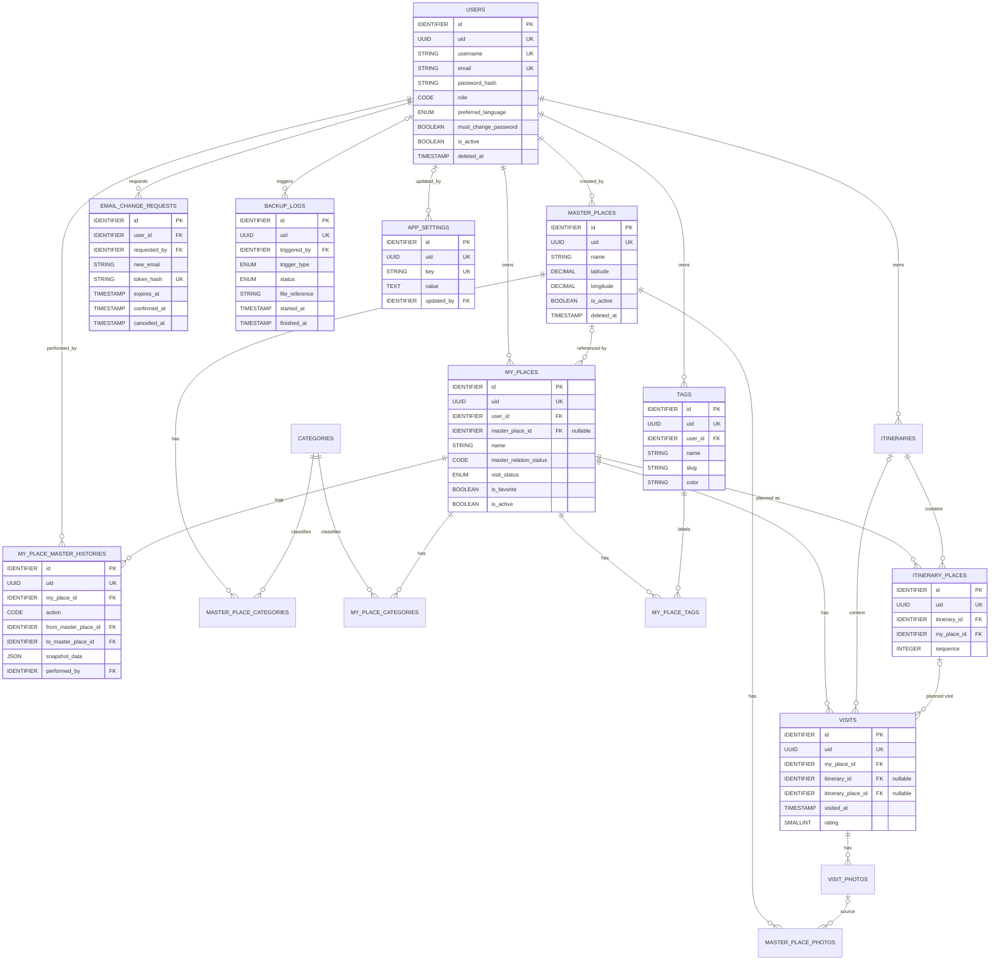

# ERD — Personal Place Journal

## 1. Document Information

| Field | Nilai |
|---|---|
| Document ID | ERD-PPJ-001 |
| Document | Entity Relationship & Database Specification |
| Application | Personal Place Journal |
| Version | 1.2.0 |
| Status | IN_REVIEW |
| Model Level | Logical |
| Target Engine | Engine-neutral (lihat SRS-PPJ-001 — `TBD`) |
| Source Baseline | BRD-PPJ-001 v1.2.0 (`result/v1.2.0/BRD_PPJ_v1.2.0.md`) |
| Phase | Phase 1 |
| Owner | Verry Prima |
| Audience | PO, BA, Developer, QA, Database Engineer, AI coding agent |
| Last Updated | 2026-10-14 |
| Purpose | Mendefinisikan entity, atribut, relasi, cardinality, constraint, index, lifecycle, delete behavior, reference data, dan aturan integritas database Personal Place Journal secara engine-neutral. |

Aturan versi: `MAJOR.MINOR.PATCH` — MAJOR = perubahan struktur yang breaking, MINOR = penambahan tabel/kolom non-breaking, PATCH = koreksi redaksi.

---

## 2. Revision History

| Versi | Tanggal | Penulis | Baseline BRD | Ringkasan Perubahan | Breaking? |
|---|---|---|---|---|---|
| 0.1.0 | 2026-08-25 | Verry Prima | BRD v2 | ERD awal | — |
| 0.2.0 | 2026-08-25 | Verry Prima | BRD v3 | ERD v2 — baseline BRD v3 (reset MASTER vs MY PLACE) | Ya |
| 0.3.0 | 2026-08-25 | Verry Prima | BRD final | ERD v3.0 — Final logical ERD Phase 1 | Ya |
| 0.3.1 | 2026-10-09 | Verry Prima | BRD final | ERD v3.1 — penambahan `uid` (UUID v7) pada entity resource API | Ya (migration) |
| 0.3.2 | 2026-10-13 | Verry Prima | BRD-PPJ-001 v1.0.0 | ERD v3.2 — `my_places.is_active`; history & itinerary_places CASCADE saat MY PLACE dihapus dengan DELETE CONSENT | Ya (migration) |
| 1.0.0 | 2026-10-13 | Verry Prima | BRD-PPJ-001 v1.0.0 | Restrukturisasi sesuai `standard/ERD_standard.md` v1.0: tipe data logis, `TIMESTAMP` UTC, penamaan constraint/index, relationship catalog, check & partial unique constraint, katalog derived values, klasifikasi data, integrity test. Perubahan skema: `users.password` → `password_hash`; kolom `code` pada `ref_user_roles`, `ref_master_relation_statuses`, `ref_master_history_actions`; `master_place_photos.created_by`; email unik case-insensitive | Ya (migration) |
| 1.1.0 | 2026-10-13 | Verry Prima | BRD-PPJ-001 v1.1.0 | Tabel baru `email_change_requests`, `app_settings`, `backup_logs`; kolom `users.preferred_language`, `users.must_change_password`; `master_places.address` NOT NULL; FK association CATEGORY menjadi RESTRICT; unique `tags (user_id, LOWER(name))` dan `itinerary_places (itinerary_id, sequence)`; check tanggal itinerary & panjang teks; rating MASTER mengecualikan user DELETED; restore user | Ya (migration) |
| 1.2.0 | 2026-10-14 | Verry Prima | BRD-PPJ-001 v1.2.0 | Kolom baru `users.username` (STRING(20), lowercase) sebagai identifier login kedua; `uq_users__username` = `UNIQUE(LOWER(username))` termasuk soft-deleted; check `ck_users__username_format`; resolusi login email/username (24.22); TX-18 ubah username | Tidak (kolom baru; expand + backfill) |

### 2.1 Keputusan Klarifikasi pada Versi 1.0.0

| No | Keputusan |
|---:|---|
| EK-01 | Dokumen ERD baru disimpan sebagai `ERD_PPJ_v1.0.0.md`; `ERD_final.md` menjadi arsip. |
| EK-02 | Kolom `users.password` diganti `users.password_hash`. |
| EK-03 | Tabel `ref_*` (kecuali `ref_tag_colors`) memisahkan `code` (nilai stabil yang disimpan di tabel bisnis) dan `name` (label tampilan). Nilai `code` sama dengan nilai sebelumnya, termasuk `RE-REFER`. |
| EK-04 | `users.email` unik secara case-insensitive (dinormalisasi lowercase) dan **tidak dapat dipakai ulang**, termasuk email milik user soft-deleted. |

### 2.2 Perubahan pada Versi 1.1.0 (dari BRD-PPJ-001 v1.1.0)

| No | Perubahan | BRD Ref |
|---:|---|---|
| EK-05 | Tabel baru: `email_change_requests` (konfirmasi perubahan email), `app_settings` (aturan foto), `backup_logs` (riwayat backup manual). | K-30, K-32, K-36 |
| EK-06 | Kolom baru `users.preferred_language` (`ID`/`EN`, default `ID`) dan `users.must_change_password`. | K-27, K-32 |
| EK-07 | `master_places.address` menjadi NOT NULL; `my_places.address` tetap opsional. | K-29, K-34 |
| EK-08 | FK `master_place_categories.category_id` dan `my_place_categories.category_id` menjadi RESTRICT agar CATEGORY yang dipakai tidak dapat dihapus. | K-39 |
| EK-09 | Constraint baru: `UNIQUE(user_id, LOWER(name))` pada `tags`; `UNIQUE(itinerary_id, sequence)`; check `end_date ≥ start_date`; panjang deskripsi/catatan ≤ 2.000 karakter. | K-29, K-34, K-43 |
| EK-10 | Rating MASTER mengecualikan VISIT milik user DELETED; `visited_at ≤ now` dan konsistensi konteks VISIT menjadi aturan tetap (Svc). | K-41, K-42, K-44 |
| EK-11 | Restore user: `deleted_at`/`deleted_by` dikosongkan dan `is_active = TRUE`. | K-45 |

### 2.3 Perubahan pada Versi 1.2.0 (dari BRD-PPJ-001 v1.2.0)

| No | Perubahan | BRD Ref |
|---:|---|---|
| EK-12 | Kolom baru `users.username` STRING(20) NOT NULL — identifier login selain email; dinormalisasi lowercase. | K-53, K-55 |
| EK-13 | Constraint baru: `uq_users__username` = `UNIQUE(LOWER(username))` mencakup baris soft-deleted; `ck_users__username_format` = panjang 4–20, karakter `a-z`, `0-9`, `.`, `_`. | K-54 |
| EK-14 | Login me-resolve identifier: mengandung `@` → `users.email`, selain itu → `users.username` (query 24.22). Username diubah langsung oleh pemilik akun (TX-18), tanpa tabel request/riwayat. | K-53, K-55 |

---

## 3. Approval / Sign-off

| Nama | Peran | Keputusan | Tanggal |
|---|---|---|---|
| Verry Prima | Product Owner | PENDING | — |
| `TBD` | Tech Lead / DBA | PENDING | — |

---

## 4. Scope & Engine-Neutral Statement

ERD ini mendefinisikan **logical data model** dan **business integrity rules** Phase 1 yang wajib dipertahankan pada engine database apa pun.

ERD **TIDAK** mendefinisikan:
- database engine/version, storage engine, charset/collation;
- mekanisme generate primary key (auto-increment/sequence/identity/UUID);
- sintaks SQL/DDL spesifik engine;
- partisi, replikasi, sharding;
- tipe data fisik (lihat Appendix 33.1 dan SRS);
- mekanisme storage file foto, autentikasi, JWT, caching (SRS).

Kolom tipe pada Data Dictionary menggunakan **tipe logis** (Section 6.4). Contoh pemetaan fisik pada Appendix bersifat non-normatif.

---

## 5. Source Baseline & BRD Traceability

| Konsep BRD (Glossary) | Requirement BRD | Tabel / Kolom ERD |
|---|---|---|
| USER, EXPLORER, ADMIN | FR-USR-001..016 | `users`, `ref_user_roles` |
| ACTIVE MODE (Admin/Explorer) | FR-USR-012..016 | — (state sesi, tidak disimpan; DD-13) |
| GUEST | FR-GST-001..003 | — (tanpa akun; query 24.2) |
| MASTER PLACE | FR-MST-001..010 | `master_places` |
| CATEGORY | FR-CAT-001..007 | `categories`, `master_place_categories`, `my_place_categories` |
| MY PLACE | FR-MYP-001..014 | `my_places` |
| MY PLACE INACTIVE | FR-MYP-013..014 | `my_places.is_active` |
| DELETE CONSENT | FR-MYP-010..012 | — (validasi service; TX-03) |
| MASTER RELATION STATUS | FR-REL-001..014 | `my_places.master_relation_status`, `ref_master_relation_statuses` |
| SUBMISSION, SNAPSHOT | FR-REL-001..010 | `my_place_master_histories` (`SUBMITTED`, `snapshot_data`) |
| MASTER RELATION HISTORY | FR-REL-014 | `my_place_master_histories`, `ref_master_history_actions` |
| FAVORITE | FR-FAV-001..002 | `my_places.is_favorite` |
| TAG | FR-TAG-001..005 | `tags`, `my_place_tags` |
| TAG COLOR REFERENCE | FR-CLR-001..002 | `ref_tag_colors`; nilai disimpan di `tags.color` |
| VISIT, PLANNED/UNEXPECTED VISIT | FR-VST-001..006 | `visits` (`itinerary_id`, `itinerary_place_id`) |
| VISIT STATUS | FR-VST-006 | `my_places.visit_status` (denormalized) |
| VISIT PHOTO | FR-VPH-001..003 | `visit_photos` |
| MASTER PLACE PHOTO | FR-MPH-001..003 | `master_place_photos` |
| ITINERARY | FR-ITN-001 | `itineraries` |
| ITINERARY PLACE | FR-ITN-002..005 | `itinerary_places` |
| Rating MY PLACE / MASTER | FR-MYP-008, FR-MST-009 | — (calculated, Section 19) |
| EFFECTIVE CATEGORY | FR-CAT-006 | — (calculated, Section 19) |
| Route planned / actual | FR-RTE-001..004 | — (query `sequence` / `visited_at`, Section 24) |
| Lokasi perangkat (titik tengah peta) | FR-MAP-005..007 | — (tidak disimpan, BR-MAP-001) |
| LANGUAGE PREFERENCE | FR-USR-021..022 | `users.preferred_language` (Guest: tidak disimpan) |
| Wajib ganti password | FR-USR-017 | `users.must_change_password` |
| USERNAME (login email/username) | FR-USR-001, FR-USR-023..024 | `users.username` |
| EMAIL CHANGE CONFIRMATION | FR-USR-018..019, FR-NTF-001 | `email_change_requests` |
| Restore user | FR-USR-020 | `users.deleted_at`, `users.deleted_by` (dikosongkan, TX-15) |
| APP SETTING (aturan foto) | FR-CFG-001..003 | `app_settings` |
| BACKUP | FR-BKP-001..005 | `backup_logs` (file di storage, SRS) |

---

## 6. Global Conventions

### 6.1 Primary Key

- Nama PK selalu `id`, unik, NOT NULL, immutable, tanpa makna bisnis (dilarang `MASTER-001`, `USER-2026-001`).
- Association table memakai **composite PK** dari kolom relasinya.
- Mekanisme generate dan tipe fisik ditentukan di SRS.

### 6.2 Public Identifier (UID)

- Entity resource API memakai `uid` — UUID v7, dibuat backend, unik, NOT NULL, immutable.
- FK dan join internal memakai `id`. API **TIDAK BOLEH** mengekspos `id`.
- UID tidak menggantikan autentikasi, otorisasi, pemeriksaan ownership, atau validasi input.

| Memakai UID | Dikecualikan (alasan) |
|---|---|
| `users`, `categories`, `master_places`, `master_place_photos`, `my_places`, `tags`, `my_place_master_histories`, `visits`, `visit_photos`, `itineraries`, `itinerary_places`, `app_settings`, `backup_logs` | `ref_*` (reference-only); `master_place_categories`, `my_place_categories`, `my_place_tags` (association, dikelola via resource parent); `email_change_requests` (diakses melalui token konfirmasi, bukan resource API) |

Jika association kelak menjadi resource mandiri, keputusan UID ditinjau ulang di SRS.

### 6.3 Naming Convention

| Objek | Aturan | Contoh |
|---|---|---|
| Tabel entitas | `snake_case`, jamak | `my_places`, `visit_photos` |
| Association | `<entitas_a_tunggal>_<entitas_b_jamak>` | `my_place_tags`, `master_place_categories` |
| Reference | prefix `ref_`, jamak | `ref_user_roles` |
| History | `<entitas_tunggal>_<konteks>_histories` | `my_place_master_histories` |
| Kolom | `snake_case` | `visited_at` |
| FK | `<entitas_tunggal>_id` | `my_place_id` |
| FK dengan peran | `<peran>_<entitas>_id` | `from_master_place_id`, `source_visit_photo_id` |
| Actor | `<aksi>_by` | `created_by`, `deleted_by`, `performed_by` |
| Boolean | prefix `is_` | `is_active`, `is_primary`, `is_favorite` |
| Timestamp | suffix `_at` | `performed_at` |
| Tanggal / jam | suffix `_date` / `_time` | `planned_date`, `planned_time` |
| Status/enum value | `UPPER_SNAKE_CASE` | `UNREFERRED`, `VISITED` (pengecualian: `RE-REFER`, keputusan BRD K-19) |
| Constraint/index | `pk_`, `fk_`, `uq_`, `ix_`, `ck_` | `uq_tags__user_id_slug` |

Dilarang: prefix teknis (`tbl_`), nama yang mengunci engine (`users_seq`), singkatan tidak baku, kata kunci SQL sebagai nama kolom, polymorphic `entity_type`/`entity_id`.

### 6.4 Logical Data Types

| Tipe Logis | Makna |
|---|---|
| `IDENTIFIER` | PK / FK internal |
| `UUID` | Identifier publik (v7) |
| `STRING(n)` | Teks pendek dengan batas panjang |
| `TEXT` | Teks panjang |
| `CODE(n)` | Nilai reference/status yang disimpan langsung |
| `ENUM{A,B}` | Domain nilai tetap |
| `INTEGER` / `SMALLINT` | Bilangan bulat |
| `DECIMAL(p,s)` | Angka presisi (koordinat) |
| `BOOLEAN` | true/false |
| `DATE` / `TIME` | Tanggal / jam |
| `TIMESTAMP` | Tanggal-waktu, disimpan UTC |
| `JSON` | Semi-terstruktur, wajib skema & `schema_version` |

Koordinat menggunakan `DECIMAL(10,7)`; tipe spasial: `TBD` (OI-09).

### 6.5 Time & Timezone

- Seluruh kolom `*_at` bertipe `TIMESTAMP` dan disimpan dalam **UTC**; konversi ke zona lokal di application layer (zona tampilan: BRD NFR-I18N-001, `TBD`).
- `created_at` diisi saat insert; `updated_at` setiap update.
- Waktu bisnis (`visited_at`, `performed_at`) dibedakan dari waktu teknis (`created_at`).
- `planned_date` (`DATE`) dan `planned_time` (`TIME`) adalah informasi perencanaan tanpa zona waktu.

### 6.6 Case-Sensitivity & Uniqueness

| Kolom | Case | Memperhitungkan soft-deleted? |
|---|---|---|
| `users.email` | Case-insensitive; dinormalisasi lowercase sebelum disimpan | Ya — email user soft-deleted tidak dapat dipakai ulang |
| `users.username` | Case-insensitive; dinormalisasi lowercase sebelum disimpan | Ya — username yang masih melekat pada user soft-deleted tidak dapat dipakai akun lain; username yang sudah diganti dapat dipakai akun lain |
| `categories.slug` | Lowercase `kebab-case` (generated) | — (tidak ada soft delete) |
| `tags.name` | Case-insensitive per user | — |
| `email_change_requests.new_email` | Lowercase; dicek terhadap `users.email` saat request & konfirmasi | Ya |
| `app_settings.key` | Lowercase dot-notation, case-sensitive | — |
| `tags.slug` | Lowercase `kebab-case` (generated) | — |
| `ref_*.code` | `UPPER_SNAKE_CASE`, case-sensitive | — |
| `ref_tag_colors.hex_code` | Disimpan uppercase `#RRGGBB` (`ASUMSI`) | — |

---

## 7. Standard Columns

| Kelompok | Kolom | Tipe Logis | Null | Berlaku Untuk |
|---|---|---|:---:|---|
| Identity | `id` | IDENTIFIER | NO | Semua tabel non-association |
| Identity | `uid` | UUID | NO | Tabel resource API (6.2) |
| Timestamp | `created_at`, `updated_at` | TIMESTAMP (UTC) | NO | Semua tabel; association & history: `created_at` saja |
| Actor | `created_by`, `updated_by`, `requested_by`, `triggered_by` | IDENTIFIER → `users.id` | NO / YES | `master_places`, `master_place_photos` (`created_by` saja), `app_settings` (`updated_by`), `email_change_requests` (`requested_by`), `backup_logs` (`triggered_by`) |
| Active flag | `is_active` | BOOLEAN default TRUE | NO | `users`, `categories`, `master_places`, `my_places`, seluruh `ref_*` |
| Soft delete | `deleted_at`, `deleted_by` | TIMESTAMP, IDENTIFIER | YES | `users`, `master_places` |
| Ordering | `sort_order` | INTEGER default 0 | NO | `categories`, `ref_*`, `visit_photos`, `master_place_photos` |
| Concurrency | `version` | INTEGER | — | Tidak dipakai Phase 1 (OI-10) |

**Invariant soft delete:**

```text
deleted_at IS NOT NULL                      →  is_active = FALSE
is_active = TRUE AND deleted_at IS NOT NULL →  TIDAK VALID
```

`my_places.is_active` adalah flag inactive biasa — `my_places` **tidak** memiliki `deleted_at`/`deleted_by`.

---

## 8. Database Design Decisions

#### DD-01 — MASTER PLACE dan MY PLACE dipisah
**Keputusan:** `master_places` (shared, Admin) dan `my_places` (personal, owner).
**Alternatif ditolak:** Satu tabel `places` dengan flag.
**Alasan:** MY PLACE harus independen; perubahan MASTER tidak boleh mengubah data personal (BRD BR-MST-001).
**Konsekuensi:** Data name/address/koordinat disimpan dua kali (snapshot personal). `my_places.master_place_id` hanya referensi.

#### DD-02 — Association CATEGORY dipisah per parent
**Keputusan:** `master_place_categories` dan `my_place_categories`.
**Alternatif ditolak:** Polymorphic `place_categories(entity_type, entity_id)`.
**Alasan:** FK dapat ditegakkan; stored MY PLACE category tidak tertimpa CATEGORY MASTER.
**Konsekuensi:** Dua association dengan struktur sama; effective category dihitung (DV-04).

#### DD-03 — FAVORITE sebagai kolom boolean
**Keputusan:** `my_places.is_favorite`.
**Alternatif ditolak:** Tabel `favorites`.
**Alasan:** Flag personal 1:1 tanpa atribut/history.

#### DD-04 — Reference table tanpa FK, dengan `code` + `name`
**Keputusan:** Tabel bisnis menyimpan `code` langsung (`users.role`, `my_places.master_relation_status`, `my_place_master_histories.action`); `ref_*` menjadi sumber nilai valid tanpa FK database.
**Alternatif ditolak:** FK ke `ref_*.id`.
**Alasan:** Nilai dapat ditambah tanpa migration; penonaktifan reference tidak merusak data existing. `name` dapat diubah tanpa mengubah data.
**Konsekuensi:** Validasi nilai dilakukan service layer.

#### DD-05 — TAG menyimpan warna aktual tanpa FK
**Keputusan:** `tags.color` menyimpan `#RRGGBB`; tidak ada `tags.color_id`.
**Alasan:** Preset dapat dinonaktifkan/diubah tanpa merusak TAG; mendukung custom color (BRD BR-CLR-001).

#### DD-06 — Konteks VISIT dengan dua kolom nullable
**Keputusan:** `visits.itinerary_id` + `visits.itinerary_place_id` (keduanya nullable).
**Alternatif ditolak:** Tabel `unexpected_visits`.
**Alasan:** Tiga bentuk visit (standalone, planned, unexpected) cukup dibedakan dengan kombinasi kolom (CR-VST-01).

#### DD-07 — Urutan actual tanpa `sequence` di VISIT
**Keputusan:** Actual order = `visited_at, id`; planned order = `itinerary_places.sequence, id`.

#### DD-08 — `visit_status` disimpan (denormalized)
**Keputusan:** `my_places.visit_status` disimpan; source of truth = keberadaan `visits`.
**Alasan:** Filter list/peta cepat.
**Konsekuensi:** Wajib disinkronkan dalam transaksi yang sama dengan insert/delete VISIT (TX-04).

#### DD-09 — Rating dan effective category tidak disimpan
**Keputusan:** Dihitung on read (Section 19).
**Alasan:** Rating MASTER bergantung pada referensi & status aktif MY PLACE yang berubah-ubah.

#### DD-10 — Soft delete hanya USER dan MASTER PLACE
**Keputusan:** `users` dan `master_places` soft delete; `my_places` inactive + physical delete dengan DELETE CONSENT; entitas personal lain physical delete.
**Alasan:** USER/MASTER direferensikan audit/history; MY PLACE adalah data personal yang boleh dihapus owner.

#### DD-11 — History terhapus hanya bersama MY PLACE (DELETE CONSENT)
**Keputusan:** `fk_my_place_master_histories__my_place_id` ON DELETE CASCADE; referensi history ke `master_places` dan `users` tetap RESTRICT.
**Alternatif ditolak:** RESTRICT (MY PLACE ber-history tidak pernah dapat dihapus).
**Alasan:** Keputusan BRD K-14 — owner boleh menghapus seluruh data terkait dengan persetujuan eksplisit.
**Konsekuensi:** Perlindungan history bergantung pada validasi consent di service layer (TX-03, DI-062).

#### DD-12 — MASTER PLACE PHOTO sebagai salinan independen dengan lineage
**Keputusan:** `master_place_photos.source_visit_photo_id` (nullable, SET NULL) + `origin_type`.
**Alasan:** Menghapus VISIT PHOTO tidak boleh menghapus MASTER PHOTO.
**Konsekuensi:** `origin_type = VISIT` dapat memiliki `source_visit_photo_id = NULL` setelah sumber dihapus; kewajiban source hanya saat pembuatan (CR-MPH-02).

#### DD-13 — Mode Admin/Explorer tidak disimpan
**Keputusan:** Mode aktif adalah state sesi; tidak ada kolom mode dan tidak ada skema personal terpisah untuk ADMIN.
**Alasan:** Data personal ADMIN memakai tabel Explorer dengan `user_id` akun ADMIN (BRD K-21).

#### DD-14 — ITINERARY PLACE boleh berulang
**Keputusan:** Tidak ada `UNIQUE(itinerary_id, my_place_id)`; `sequence` membedakan setiap stop.

#### DD-15 — Email tidak dapat dipakai ulang
**Keputusan:** `uq_users__email` mencakup seluruh baris termasuk soft-deleted; case-insensitive.
**Alasan:** Menjaga keterlacakan akun dan audit actor (EK-04).

#### DD-20 — Username sebagai kolom pada `users`, tanpa riwayat
**Keputusan:** `users.username` disimpan lowercase dengan `uq_users__username` yang mencakup baris soft-deleted; perubahan langsung meng-update kolom (TX-18). Username lama tidak dicadangkan.
**Alternatif ditolak:** Tabel `username_histories` / reservasi username lama.
**Alasan:** BRD K-55 tidak mensyaratkan konfirmasi maupun jejak perubahan username; keunikan cukup ditegakkan pada nilai saat ini.

#### DD-16 — Aturan foto sebagai tabel konfigurasi key-value
**Keputusan:** `app_settings(key, value)`; key ditetapkan melalui migration/seed, Admin hanya mengubah `value`.
**Alternatif ditolak:** Konstanta hard-coded; kolom per aturan pada tabel khusus.
**Alasan:** Admin dapat mengubah aturan tanpa deploy (BRD K-36); key baru cukup ditambah via seed.
**Konsekuensi:** Validasi tipe nilai per key di service layer.

#### DD-17 — Perubahan email melalui tabel request bertoken
**Keputusan:** `email_change_requests` menyimpan `new_email`, `token_hash`, `expires_at`; `users.email` hanya berubah pada konfirmasi (TX-12).
**Alternatif ditolak:** Kolom `pending_email` pada `users`.
**Alasan:** Mendukung kedaluwarsa, pembatalan, dan jejak request tanpa mencemari tabel `users`.
**Konsekuensi:** Tidak ber-UID (diakses via token); maksimal satu request terbuka per user.

#### DD-18 — Riwayat backup di `backup_logs`
**Keputusan:** Setiap backup manual (dan terjadwal pada Fase 2) dicatat sebagai baris `backup_logs`; file backup berada di media penyimpanan (SRS).
**Alasan:** Admin perlu melihat status dan mengunduh hasil backup (BRD FR-BKP-002..003).

#### DD-19 — CATEGORY yang dipakai tidak dapat dihapus
**Keputusan:** FK `*_categories.category_id` ON DELETE RESTRICT.
**Alternatif ditolak:** CASCADE (menghapus klasifikasi data existing).
**Alasan:** BRD K-39 — hard delete hanya bila belum pernah dipakai; selain itu dinonaktifkan.

---

## 9. Entity Relationship Overview

```text
USERS
 ├──< MY_PLACES
 │      ├──> MASTER_PLACES (optional, 0..1)
 │      ├──< MY_PLACE_CATEGORIES >── CATEGORIES
 │      ├──< MY_PLACE_TAGS >──────── TAGS
 │      ├──< VISITS
 │      │      ├──> ITINERARIES (context, optional)
 │      │      ├──> ITINERARY_PLACES (context, optional)
 │      │      └──< VISIT_PHOTOS
 │      └──< MY_PLACE_MASTER_HISTORIES
 ├──< TAGS
 └──< ITINERARIES
        └──< ITINERARY_PLACES ──> MY_PLACES

MASTER_PLACES
 ├──< MASTER_PLACE_CATEGORIES >── CATEGORIES
 ├──< MASTER_PLACE_PHOTOS ──> VISIT_PHOTOS (source, optional)
 └──< MY_PLACES (referenced by)

USERS
 ├──< EMAIL_CHANGE_REQUESTS (user_id, requested_by)
 └──< BACKUP_LOGS (triggered_by)

APP_SETTINGS (updated_by ──> USERS)

REFERENCE (no FK)
 ├── REF_USER_ROLES                → users.role
 ├── REF_MASTER_RELATION_STATUSES  → my_places.master_relation_status
 ├── REF_MASTER_HISTORY_ACTIONS    → my_place_master_histories.action
 └── REF_TAG_COLORS                → preset untuk tags.color
```

---

## 10. Table Inventory & Classification

| Tabel | Klasifikasi | Ownership | UID | Soft Delete | Inactive | Est. Volume |
|---|---|---|:---:|:---:|:---:|---|
| users | Core | System (dikelola Admin) | ✅ | ✅ | ✅ | `TBD` |
| categories | Core – shared master | Admin | ✅ | ❌ | ✅ | < 100 |
| master_places | Core – shared | Admin | ✅ | ✅ | ✅ | `TBD` |
| master_place_photos | Core – shared | Admin | ✅ | ❌ | ❌ | `TBD` |
| my_places | Core – personal | Owner | ✅ | ❌ | ✅ | `TBD` |
| tags | Core – personal | Owner | ✅ | ❌ | ❌ | `TBD` |
| visits | Core – personal | Owner (via my_places) | ✅ | ❌ | ❌ | `TBD` |
| visit_photos | Core – personal | Owner (via visits) | ✅ | ❌ | ❌ | `TBD` |
| itineraries | Core – personal | Owner | ✅ | ❌ | ❌ | `TBD` |
| itinerary_places | Core – personal | Owner (via itineraries) | ✅ | ❌ | ❌ | `TBD` |
| email_change_requests | Core – account | User ybs | ❌ | ❌ | ❌ | Kecil |
| app_settings | Core – configuration | Admin | ✅ | ❌ | ❌ | < 50 |
| backup_logs | Log | Admin | ✅ | ❌ | ❌ | Kecil |
| master_place_categories | Association | Admin (via parent) | ❌ | ❌ | ❌ | `TBD` |
| my_place_categories | Association | Owner (via parent) | ❌ | ❌ | ❌ | `TBD` |
| my_place_tags | Association | Owner (via parent) | ❌ | ❌ | ❌ | `TBD` |
| my_place_master_histories | History (append-only) | System | ✅ | ❌ | ❌ | `TBD` |
| ref_user_roles | Reference | System | ❌ | ❌ | ✅ | 2 |
| ref_master_relation_statuses | Reference | System | ❌ | ❌ | ✅ | 4 |
| ref_master_history_actions | Reference | System | ❌ | ❌ | ✅ | 5 |
| ref_tag_colors | Reference | System (Admin) | ❌ | ❌ | ✅ | 10+ |

**Total:** 12 core + 3 association + 1 history + 1 log + 4 reference = **21 tabel**.

> Koreksi dari ERD v3.x yang menyebut "15 core business tables / 19 tables": jumlah tabel tidak berubah; perbedaan berasal dari salah hitung.

---

## 11. Business-to-Database Mapping

| Business Concept (BRD) | Tabel / Kolom | Catatan |
|---|---|---|
| User / Explorer / Admin | `users`, `users.role` | Soft delete |
| Mode Admin/Explorer | — | State sesi (DD-13) |
| Master Place | `master_places` | Shared, soft delete, inactive |
| Category | `categories` | Shared master, inactive |
| Master Place Category | `master_place_categories` | Association |
| Master Place Photo | `master_place_photos` | Independen, lineage ke VISIT PHOTO |
| My Place | `my_places` | Personal snapshot, inactive, physical delete |
| My Place Category | `my_place_categories` | Stored category personal |
| Favorite | `my_places.is_favorite` | Bukan tabel |
| Tag | `tags` | Personal |
| My Place Tag | `my_place_tags` | Association, owner sama |
| Tag Color Reference | `ref_tag_colors` | Preset; nilai di `tags.color` |
| Master Relation Status | `my_places.master_relation_status` | Code dari `ref_master_relation_statuses` |
| Submission / Snapshot | `my_place_master_histories` (`SUBMITTED`, `snapshot_data`) | Tidak ada tabel submission terpisah |
| Master Relation History | `my_place_master_histories` | Append-only |
| Visit | `visits` | |
| Visit Status | `my_places.visit_status` | Denormalized (DV-01) |
| Visit Photo | `visit_photos` | |
| Itinerary | `itineraries` | |
| Itinerary Place | `itinerary_places` | Boleh berulang |
| Rating MY PLACE / MASTER | — | Calculated (DV-02, DV-03) |
| Effective Category | — | Calculated (DV-04) |
| Delete Consent | — | Validasi service (TX-03) |
| Language Preference | `users.preferred_language` | |
| Wajib ganti password | `users.must_change_password` | |
| Username | `users.username` | Identifier login kedua; diubah pemilik akun (TX-18) |
| Email Change Confirmation | `email_change_requests` | Token hash, 24 jam |
| App Setting (aturan foto) | `app_settings` | Key-value |
| Backup | `backup_logs` | File di media penyimpanan (SRS) |

---

## 12. Data Dictionary

Kolom **Key**: PK, FK, UQ, IX. Kolom **PII**: ✅ = data pribadi (Section 25).

### 12.1 TABLE: users

**Purpose:** Akun aplikasi (Explorer dan Admin).
**Classification:** Core  **Ownership:** System (dikelola Admin)  **UID:** Ya  **Soft delete:** Ya
**BRD Ref:** FR-USR-001..016, FR-USR-023..024

| # | Column | Logical Type | Null | Key | Default | Constraint / Rule | PII | Description |
|---:|---|---|:---:|---|---|---|:---:|---|
| 1 | id | IDENTIFIER | NO | PK | generated | immutable | | ID internal |
| 2 | uid | UUID | NO | UQ | backend (v7) | immutable | | ID publik |
| 3 | name | STRING(255) | NO | | — | wajib; maks 255 karakter | ✅ | Nama user |
| 4 | username | STRING(20) | NO | UQ | — | 4–20 karakter `a-z`, `0-9`, `.`, `_`; lowercase; unik case-insensitive termasuk soft-deleted | ✅ | Identifier login (selain email); dapat diganti pemilik akun |
| 5 | email | STRING(255) | NO | UQ | — | format email; lowercase; unik case-insensitive termasuk soft-deleted | ✅ | Identifier login |
| 6 | password_hash | STRING(255) | NO | | — | hash; algoritma di SRS; tidak pernah dikembalikan API | ✅ | Hash password |
| 7 | role | CODE(50) | NO | IX | `EXPLORER` | ∈ `ref_user_roles.code` (tanpa FK) | | Role akun |
| 8 | preferred_language | ENUM{ID,EN} | NO | | `ID` | | | Bahasa antarmuka |
| 9 | must_change_password | BOOLEAN | NO | | FALSE | TRUE saat akun dibuat / password di-reset | | Wajib ganti password |
| 10 | deleted_by | IDENTIFIER | YES | FK, IX | NULL | → users.id | | Admin yang menghapus |
| 11 | is_active | BOOLEAN | NO | IX | TRUE | | | Status aktif |
| 12 | deleted_at | TIMESTAMP | YES | IX | NULL | | | Waktu soft delete |
| 13 | created_at | TIMESTAMP | NO | | now (UTC) | | | |
| 14 | updated_at | TIMESTAMP | NO | | now (UTC) | | | |

#### Column Rules
- `password_hash` — password minimal 8 karakter; password hasil generate 12 karakter (BRD K-33).
- `must_change_password` — di-set TRUE saat akun dibuat dan saat reset password (TX-13); di-set FALSE setelah user mengganti password. Selama TRUE, user hanya dapat mengakses fitur ganti password (Svc).
- `preferred_language` — hanya mengatur teks antarmuka; data yang diinput user tidak diterjemahkan.
- `password_hash` — password asal HARUS memuat huruf kecil, huruf besar, angka, dan simbol; panjang minimum `TBD` (BRD OI-10). Komposisi divalidasi service layer sebelum di-hash.
- `role` — `ADMIN` hanya melalui seed; aplikasi hanya membuat `EXPLORER` pada Phase 1 (Service).
- `username` — wajib diisi Admin saat create Explorer (TX-13) atau melalui seed untuk Admin awal; dinormalisasi lowercase sebelum validasi & simpan; tidak boleh mengandung `@` (pembeda dengan email saat login, query 24.22). Hanya pemilik akun yang dapat mengubah (TX-18); Admin tidak mengubah username Explorer (BRD BR-USR-017). Perubahan tidak menghasilkan history.
- Mode aktif Admin/Explorer tidak disimpan (DD-13).

#### Conditional Rules
```text
deleted_at IS NOT NULL → is_active = FALSE
is_active = FALSE      → tidak dapat login
```

#### Lifecycle / Delete
Soft delete; owned data tetap tersimpan namun tidak dapat diakses (Section 20). Restore oleh Admin: `deleted_at = NULL`, `deleted_by = NULL`, `is_active = TRUE` (TX-15).

---

### 12.2 TABLE: categories

**Purpose:** Master klasifikasi domain tempat.
**Classification:** Core – shared master  **Ownership:** Admin  **UID:** Ya  **Soft delete:** Tidak (inactive)
**BRD Ref:** FR-CAT-001..007

| # | Column | Logical Type | Null | Key | Default | Constraint / Rule | PII | Description |
|---:|---|---|:---:|---|---|---|:---:|---|
| 1 | id | IDENTIFIER | NO | PK | generated | immutable | | |
| 2 | uid | UUID | NO | UQ | backend (v7) | immutable | | |
| 3 | name | STRING(255) | NO | | — | wajib | | Nama kategori |
| 4 | slug | STRING(255) | NO | UQ | generated dari name | `kebab-case`, unik | | Identifier URL-friendly |
| 5 | description | TEXT | YES | | NULL | | | |
| 6 | sort_order | INTEGER | NO | IX | 0 | ≥ 0 | | Urutan tampilan |
| 7 | is_active | BOOLEAN | NO | IX | TRUE | | | Status aktif |
| 8 | created_at | TIMESTAMP | NO | | now (UTC) | | | |
| 9 | updated_at | TIMESTAMP | NO | | now (UTC) | | | |

#### Lifecycle / Delete
Inactive: tidak tersedia untuk pemilihan baru; association existing tetap. Physical delete hanya bila tidak memiliki association (FK RESTRICT, DD-19).

---

### 12.3 TABLE: master_places

**Purpose:** Data tempat bersama/terstandarisasi.
**Classification:** Core – shared  **Ownership:** Admin  **UID:** Ya  **Soft delete:** Ya
**BRD Ref:** FR-MST-001..010, FR-GST-001..003

| # | Column | Logical Type | Null | Key | Default | Constraint / Rule | PII | Description |
|---:|---|---|:---:|---|---|---|:---:|---|
| 1 | id | IDENTIFIER | NO | PK | generated | immutable | | |
| 2 | uid | UUID | NO | UQ | backend (v7) | immutable | | |
| 3 | google_place_id | STRING(255) | YES | IX | NULL | | | ID Google Places |
| 4 | name | STRING(255) | NO | | — | wajib | | Nama tempat |
| 5 | address | TEXT | NO | | — | wajib | | Alamat |
| 6 | description | TEXT | YES | | NULL | | | |
| 7 | latitude | DECIMAL(10,7) | NO | IX | — | -90..90 | | |
| 8 | longitude | DECIMAL(10,7) | NO | IX | — | -180..180 | | |
| 9 | created_by | IDENTIFIER | NO | FK, IX | — | → users.id (Admin) | | Pembuat |
| 10 | updated_by | IDENTIFIER | YES | FK, IX | NULL | → users.id (Admin) | | Pengubah terakhir |
| 11 | deleted_by | IDENTIFIER | YES | FK, IX | NULL | → users.id (Admin) | | Penghapus |
| 12 | is_active | BOOLEAN | NO | IX | TRUE | | | |
| 13 | deleted_at | TIMESTAMP | YES | IX | NULL | | | |
| 14 | created_at | TIMESTAMP | NO | | now (UTC) | | | |
| 15 | updated_at | TIMESTAMP | NO | | now (UTC) | | | |

#### Conditional Rules
```text
ACTIVE   : is_active = TRUE  AND deleted_at IS NULL
INACTIVE : is_active = FALSE AND deleted_at IS NULL
DELETED  : is_active = FALSE AND deleted_at IS NOT NULL
is_active = TRUE AND deleted_at IS NOT NULL → TIDAK VALID
```

#### Lifecycle / Delete
Soft delete + automatic UNREFER (TX-01). Tidak ada physical delete melalui workflow bisnis; tidak ada restore Phase 1.

---

### 12.4 TABLE: master_place_categories

**Purpose:** Association MASTER PLACE ↔ CATEGORY.
**Classification:** Association  **Ownership:** Admin (via parent)  **UID:** Tidak  **Soft delete:** Tidak
**BRD Ref:** FR-MST-004

| # | Column | Logical Type | Null | Key | Default | Constraint / Rule | PII | Description |
|---:|---|---|:---:|---|---|---|:---:|---|
| 1 | master_place_id | IDENTIFIER | NO | PK, FK | — | → master_places.id | | |
| 2 | category_id | IDENTIFIER | NO | PK, FK, IX | — | → categories.id; CATEGORY aktif saat ditambahkan | | |
| 3 | created_at | TIMESTAMP | NO | | now (UTC) | | | |

#### Lifecycle / Delete
Tidak terhapus saat MASTER di-soft-delete (MASTER tetap ada secara fisik).

---

### 12.5 TABLE: master_place_photos

**Purpose:** Foto shared MASTER PLACE.
**Classification:** Core – shared  **Ownership:** Admin  **UID:** Ya  **Soft delete:** Tidak
**BRD Ref:** FR-MPH-001..003

| # | Column | Logical Type | Null | Key | Default | Constraint / Rule | PII | Description |
|---:|---|---|:---:|---|---|---|:---:|---|
| 1 | id | IDENTIFIER | NO | PK | generated | immutable | | |
| 2 | uid | UUID | NO | UQ | backend (v7) | immutable | | |
| 3 | master_place_id | IDENTIFIER | NO | FK, IX | — | → master_places.id | | Parent |
| 4 | source_visit_photo_id | IDENTIFIER | YES | FK, IX | NULL | → visit_photos.id | | Lineage sumber |
| 5 | file_path | STRING(1000) | YES | | NULL | lihat CR-MPH-01 | | Path internal |
| 6 | external_url | TEXT | YES | | NULL | lihat CR-MPH-01 | | URL eksternal |
| 7 | file_name | STRING(255) | YES | | NULL | | | |
| 8 | caption | TEXT | YES | | NULL | | | |
| 9 | storage_type | ENUM{UPLOAD,EXTERNAL,S3} | NO | IX | `UPLOAD` | | | Mekanisme storage |
| 10 | origin_type | ENUM{ADMIN,VISIT} | NO | IX | `ADMIN` | | | Asal foto |
| 11 | is_primary | BOOLEAN | NO | IX | FALSE | maks satu per MASTER | | |
| 12 | sort_order | INTEGER | NO | IX | 0 | ≥ 0 | | |
| 13 | created_by | IDENTIFIER | NO | FK, IX | — | → users.id (Admin) | | Pembuat (baru v1.0.0) |
| 14 | created_at | TIMESTAMP | NO | | now (UTC) | | | |
| 15 | updated_at | TIMESTAMP | NO | | now (UTC) | | | |

#### Conditional Rules
```text
CR-MPH-01 Storage
storage_type = 'UPLOAD'   → file_path NOT NULL, external_url NULL
storage_type = 'EXTERNAL' → external_url NOT NULL, file_path NULL
storage_type = 'S3'       → metadata/key ditentukan SRS (OI-08)

CR-MPH-02 Origin
origin_type = 'VISIT' → source_visit_photo_id WAJIB saat insert (Service);
                        boleh menjadi NULL setelah VISIT PHOTO sumber dihapus (SET NULL)
origin_type = 'ADMIN' → source_visit_photo_id NULL

CR-MPH-03 Sumber (Svc)
source_visit_photo_id saat insert → VISIT PHOTO dari MY PLACE yang saat ini
                                    mereferensikan master_place_id yang sama

CR-MPH-04 Batas (Svc)
Tipe, ukuran, dan jumlah per MASTER sesuai app_settings saat upload; EXIF GPS dihapus
```

#### Lifecycle / Delete
Physical delete oleh Admin. Tidak terpengaruh penghapusan VISIT PHOTO, VISIT, MY PLACE, atau USER. Penghapusan primary tidak memilih pengganti otomatis.

---

### 12.6 TABLE: my_places

**Purpose:** Data tempat personal milik Explorer (termasuk akun ADMIN dalam mode Explorer).
**Classification:** Core – personal  **Ownership:** Owner (`user_id`)  **UID:** Ya  **Soft delete:** Tidak (inactive + physical delete)
**BRD Ref:** FR-MYP-001..014, FR-REL-001..014, FR-FAV-001..002

| # | Column | Logical Type | Null | Key | Default | Constraint / Rule | PII | Description |
|---:|---|---|:---:|---|---|---|:---:|---|
| 1 | id | IDENTIFIER | NO | PK | generated | immutable | | |
| 2 | uid | UUID | NO | UQ | backend (v7) | immutable | | |
| 3 | user_id | IDENTIFIER | NO | FK, IX | — | → users.id; immutable | | Owner |
| 4 | master_place_id | IDENTIFIER | YES | FK, IX | NULL | → master_places.id; saat di-set: MASTER `ACTIVE` | | Referensi MASTER |
| 5 | google_place_id | STRING(255) | YES | IX | NULL | | | ID Google Places |
| 6 | name | STRING(255) | NO | | — | wajib | | Nama personal |
| 7 | address | TEXT | YES | | NULL | opsional | ✅ | Alamat |
| 8 | description | TEXT | YES | | NULL | | | |
| 9 | latitude | DECIMAL(10,7) | NO | IX | — | -90..90 | ✅ | |
| 10 | longitude | DECIMAL(10,7) | NO | IX | — | -180..180 | ✅ | |
| 11 | master_relation_status | CODE(50) | NO | IX | `UNREFERRED` | ∈ `ref_master_relation_statuses.code` (tanpa FK) | | State relasi MASTER |
| 12 | visit_status | ENUM{PLAN,VISITED} | NO | IX | `PLAN` | denormalized (DV-01) | | State kunjungan |
| 13 | is_favorite | BOOLEAN | NO | IX | FALSE | | | FAVORITE |
| 14 | is_active | BOOLEAN | NO | IX | TRUE | | | Status aktif MY PLACE |
| 15 | created_at | TIMESTAMP | NO | | now (UTC) | | | |
| 16 | updated_at | TIMESTAMP | NO | | now (UTC) | | | |

#### Conditional Rules
```text
CR-MYP-01  master_relation_status = 'REFERRED'  ↔  master_place_id IS NOT NULL
CR-MYP-02  is_active = FALSE → tidak boleh: itinerary_places baru, visits baru, SUBMIT/RESUBMIT (Service)
CR-MYP-03  is_active, master_relation_status, visit_status adalah tiga state independen
```

#### Lifecycle / Delete
Inactive oleh owner (tanpa history). Physical delete oleh owner dengan aturan DELETE CONSENT (TX-03).

---

### 12.7 TABLE: my_place_categories

**Purpose:** Stored CATEGORY personal MY PLACE.
**Classification:** Association  **Ownership:** Owner (via parent)  **UID:** Tidak  **Soft delete:** Tidak
**BRD Ref:** FR-CAT-004..006

| # | Column | Logical Type | Null | Key | Default | Constraint / Rule | PII | Description |
|---:|---|---|:---:|---|---|---|:---:|---|
| 1 | my_place_id | IDENTIFIER | NO | PK, FK | — | → my_places.id | | |
| 2 | category_id | IDENTIFIER | NO | PK, FK, IX | — | → categories.id; CATEGORY aktif saat ditambahkan | | |
| 3 | created_at | TIMESTAMP | NO | | now (UTC) | | | |

#### Lifecycle / Delete
Tidak diubah/dihapus oleh perubahan CATEGORY MASTER atau penghapusan MASTER. Terhapus bersama MY PLACE.

---

### 12.8 TABLE: tags

**Purpose:** Grouping personal milik Explorer.
**Classification:** Core – personal  **Ownership:** Owner (`user_id`)  **UID:** Ya  **Soft delete:** Tidak
**BRD Ref:** FR-TAG-001..005

| # | Column | Logical Type | Null | Key | Default | Constraint / Rule | PII | Description |
|---:|---|---|:---:|---|---|---|:---:|---|
| 1 | id | IDENTIFIER | NO | PK | generated | immutable | | |
| 2 | uid | UUID | NO | UQ | backend (v7) | immutable | | |
| 3 | user_id | IDENTIFIER | NO | FK, IX | — | → users.id | | Owner |
| 4 | name | STRING(255) | NO | UQ (user_id, LOWER(name)) | — | wajib; unik per user, case-insensitive | | Nama TAG |
| 5 | slug | STRING(255) | NO | UQ (user_id, slug) | generated dari name | `kebab-case`; unik per user | | |
| 6 | color | STRING(7) | NO | | `#64748B` | `^#[0-9A-Fa-f]{6}$` | | Warna aktual |
| 7 | created_at | TIMESTAMP | NO | | now (UTC) | | | |
| 8 | updated_at | TIMESTAMP | NO | | now (UTC) | | | |

#### Lifecycle / Delete
Physical delete; hanya `my_place_tags` ikut terhapus.

---

### 12.9 TABLE: my_place_tags

**Purpose:** Association MY PLACE ↔ TAG.
**Classification:** Association  **Ownership:** Owner (via parent)  **UID:** Tidak  **Soft delete:** Tidak
**BRD Ref:** FR-TAG-003

| # | Column | Logical Type | Null | Key | Default | Constraint / Rule | PII | Description |
|---:|---|---|:---:|---|---|---|:---:|---|
| 1 | my_place_id | IDENTIFIER | NO | PK, FK | — | → my_places.id | | |
| 2 | tag_id | IDENTIFIER | NO | PK, FK, IX | — | → tags.id; `tags.user_id = my_places.user_id` (Service) | | |
| 3 | created_at | TIMESTAMP | NO | | now (UTC) | | | |

---

### 12.10 TABLE: my_place_master_histories

**Purpose:** Audit trail append-only lifecycle relasi MY PLACE ↔ MASTER PLACE, termasuk snapshot pengajuan.
**Classification:** History  **Ownership:** System  **UID:** Ya  **Soft delete:** Tidak
**BRD Ref:** FR-REL-005, FR-REL-014, BRD Section 18

| # | Column | Logical Type | Null | Key | Default | Constraint / Rule | PII | Description |
|---:|---|---|:---:|---|---|---|:---:|---|
| 1 | id | IDENTIFIER | NO | PK | generated | immutable | | |
| 2 | uid | UUID | NO | UQ | backend (v7) | immutable | | |
| 3 | my_place_id | IDENTIFIER | NO | FK, IX | — | → my_places.id | | MY PLACE |
| 4 | from_master_place_id | IDENTIFIER | YES | FK, IX | NULL | → master_places.id | | MASTER sebelumnya |
| 5 | to_master_place_id | IDENTIFIER | YES | FK, IX | NULL | → master_places.id | | MASTER tujuan |
| 6 | action | CODE(50) | NO | IX | — | ∈ `ref_master_history_actions.code` (tanpa FK) | | Business action |
| 7 | snapshot_data | JSON | YES | | NULL | struktur di bawah | ✅ | Snapshot pengajuan |
| 8 | reason | TEXT | YES | | NULL | wajib untuk `REJECTED` & UNREFER otomatis | | Alasan |
| 9 | note | TEXT | YES | | NULL | | | Catatan |
| 10 | performed_by | IDENTIFIER | NO | FK, IX | — | → users.id | | Actor |
| 11 | performed_at | TIMESTAMP | NO | IX | now (UTC) | | | Waktu action |
| 12 | created_at | TIMESTAMP | NO | | now (UTC) | | | Waktu record |

Tidak ada `updated_at` — tabel append-only.

#### Conditional Rules (per action)

| Action | from_master_place_id | to_master_place_id | snapshot_data | reason |
|---|---|---|---|---|
| `SUBMITTED` | NULL | NULL | wajib | — |
| `REJECTED` | NULL | NULL | wajib (snapshot pengajuan yang ditolak) | wajib |
| `REFERRED` | NULL | wajib | — | opsional |
| `RE-REFER` | wajib | wajib (≠ from) | — | opsional |
| `UNREFERRED` (manual) | wajib | NULL | — | opsional |
| `UNREFERRED` (MASTER dihapus) | wajib | NULL | — | wajib = `MASTER PLACE dihapus` |

#### JSON Structure — `snapshot_data` (`ASUMSI`, OI-06)
```json
{
  "schema_version": 1,
  "name": "Cafe ABC",
  "address": "Jl. Contoh No. 1",
  "description": "string|null",
  "latitude": -7.9666200,
  "longitude": 112.6326300,
  "google_place_id": "string|null",
  "category_codes": ["cafe"]
}
```
`category_codes` berisi `categories.slug` dari stored MY PLACE category saat pengajuan.

#### Lifecycle / Delete
Tidak dapat di-update/dihapus secara mandiri. Satu-satunya penghapusan: CASCADE saat MY PLACE dihapus dengan DELETE CONSENT (DD-11).

---

### 12.11 TABLE: visits

**Purpose:** Catatan kunjungan aktual ke MY PLACE.
**Classification:** Core – personal  **Ownership:** Owner (via my_places)  **UID:** Ya  **Soft delete:** Tidak
**BRD Ref:** FR-VST-001..006

| # | Column | Logical Type | Null | Key | Default | Constraint / Rule | PII | Description |
|---:|---|---|:---:|---|---|---|:---:|---|
| 1 | id | IDENTIFIER | NO | PK | generated | immutable | | |
| 2 | uid | UUID | NO | UQ | backend (v7) | immutable | | |
| 3 | my_place_id | IDENTIFIER | NO | FK, IX | — | → my_places.id; immutable | | MY PLACE |
| 4 | itinerary_id | IDENTIFIER | YES | FK, IX | NULL | → itineraries.id; owner sama | | Konteks itinerary |
| 5 | itinerary_place_id | IDENTIFIER | YES | FK, IX | NULL | → itinerary_places.id | | Konteks planned stop |
| 6 | visited_at | TIMESTAMP | NO | IX | — | wajib; ≤ waktu saat ini (Svc) | ✅ | Waktu kunjungan aktual |
| 7 | rating | SMALLINT | YES | | NULL | NULL atau 1..5 | | Rating |
| 8 | note | TEXT | YES | | NULL | | ✅ | Catatan kunjungan |
| 9 | created_at | TIMESTAMP | NO | | now (UTC) | | | |
| 10 | updated_at | TIMESTAMP | NO | | now (UTC) | | | |

#### Conditional Rules
```text
CR-VST-01 Visit context
Standalone : itinerary_id IS NULL     AND itinerary_place_id IS NULL
Planned    : itinerary_id IS NOT NULL AND itinerary_place_id IS NOT NULL
Unexpected : itinerary_id IS NOT NULL AND itinerary_place_id IS NULL
Tidak valid: itinerary_id IS NULL     AND itinerary_place_id IS NOT NULL

CR-VST-02 Konsistensi (BRD K-41)
itinerary_place_id NOT NULL → itinerary_places.my_place_id = visits.my_place_id
                              AND itinerary_places.itinerary_id = visits.itinerary_id

CR-VST-03 Insert hanya untuk my_places.is_active = TRUE (Service)
```

Catatan: setelah ITINERARY PLACE dihapus, `itinerary_place_id` menjadi NULL sementara `itinerary_id` tetap → VISIT diperlakukan sebagai unexpected visit dalam konteks ITINERARY.

#### Lifecycle / Delete
Physical delete; VISIT PHOTO ikut terhapus; `visit_status` disinkronkan (TX-04).

---

### 12.12 TABLE: visit_photos

**Purpose:** Foto dokumentasi VISIT.
**Classification:** Core – personal  **Ownership:** Owner (via visits)  **UID:** Ya  **Soft delete:** Tidak
**BRD Ref:** FR-VPH-001..003

| # | Column | Logical Type | Null | Key | Default | Constraint / Rule | PII | Description |
|---:|---|---|:---:|---|---|---|:---:|---|
| 1 | id | IDENTIFIER | NO | PK | generated | immutable | | |
| 2 | uid | UUID | NO | UQ | backend (v7) | immutable | | |
| 3 | visit_id | IDENTIFIER | NO | FK, IX | — | → visits.id | | Parent |
| 4 | file_path | STRING(1000) | YES | | NULL | lihat CR-VPH-01 | | |
| 5 | external_url | TEXT | YES | | NULL | lihat CR-VPH-01 | | |
| 6 | file_name | STRING(255) | YES | | NULL | | | |
| 7 | caption | TEXT | YES | | NULL | | ✅ | |
| 8 | storage_type | ENUM{UPLOAD,EXTERNAL,S3} | NO | IX | `UPLOAD` | | | |
| 9 | is_primary | BOOLEAN | NO | IX | FALSE | maks satu per VISIT | | |
| 10 | sort_order | INTEGER | NO | IX | 0 | ≥ 0 | | |
| 11 | created_at | TIMESTAMP | NO | | now (UTC) | | | |
| 12 | updated_at | TIMESTAMP | NO | | now (UTC) | | | |

#### Conditional Rules
```text
CR-VPH-01 Storage — sama dengan CR-MPH-01
```

Metadata lokasi GPS (EXIF) dihapus saat upload; tipe, ukuran, dan jumlah per VISIT divalidasi terhadap `app_settings` (Svc).

---

### 12.13 TABLE: itineraries

**Purpose:** Rencana perjalanan milik Explorer.
**Classification:** Core – personal  **Ownership:** Owner (`user_id`)  **UID:** Ya  **Soft delete:** Tidak
**BRD Ref:** FR-ITN-001

| # | Column | Logical Type | Null | Key | Default | Constraint / Rule | PII | Description |
|---:|---|---|:---:|---|---|---|:---:|---|
| 1 | id | IDENTIFIER | NO | PK | generated | immutable | | |
| 2 | uid | UUID | NO | UQ | backend (v7) | immutable | | |
| 3 | user_id | IDENTIFIER | NO | FK, IX | — | → users.id | | Owner |
| 4 | name | STRING(255) | NO | | — | wajib | | |
| 5 | description | TEXT | YES | | NULL | | | |
| 6 | start_date | DATE | YES | IX | NULL | label perencanaan | | |
| 7 | end_date | DATE | YES | IX | NULL | label perencanaan; `≥ start_date` bila keduanya diisi | | |
| 8 | created_at | TIMESTAMP | NO | | now (UTC) | | | |
| 9 | updated_at | TIMESTAMP | NO | | now (UTC) | | | |

Tidak ada status lifecycle. `start_date`/`end_date` TIDAK membatasi `visits.visited_at`.

---

### 12.14 TABLE: itinerary_places

**Purpose:** Planned stop (occurrence) dalam ITINERARY.
**Classification:** Core – personal  **Ownership:** Owner (via itineraries)  **UID:** Ya  **Soft delete:** Tidak
**BRD Ref:** FR-ITN-002..005

| # | Column | Logical Type | Null | Key | Default | Constraint / Rule | PII | Description |
|---:|---|---|:---:|---|---|---|:---:|---|
| 1 | id | IDENTIFIER | NO | PK | generated | immutable | | |
| 2 | uid | UUID | NO | UQ | backend (v7) | immutable | | |
| 3 | itinerary_id | IDENTIFIER | NO | FK, IX | — | → itineraries.id | | Parent |
| 4 | my_place_id | IDENTIFIER | NO | FK, IX | — | → my_places.id; owner sama; MY PLACE aktif saat insert | | Tempat |
| 5 | planned_date | DATE | YES | IX | NULL | | | Tanggal rencana |
| 6 | planned_time | TIME | YES | | NULL | | | Jam rencana |
| 7 | note | TEXT | YES | | NULL | catatan **perencanaan** saja (bukan factual note) | | |
| 8 | sequence | INTEGER | NO | UQ (itinerary_id, sequence) | — | ≥ 1; unik per itinerary; diurutkan ulang otomatis (TX-17) | | Urutan planned |
| 9 | created_at | TIMESTAMP | NO | | now (UTC) | | | |
| 10 | updated_at | TIMESTAMP | NO | | now (UTC) | | | |

---

### 12.15 TABLE: ref_user_roles

**Purpose:** Daftar nilai role. **Classification:** Reference  **UID:** Tidak  **BRD Ref:** FR-USR-002..003

| # | Column | Logical Type | Null | Key | Default | Constraint / Rule | Description |
|---:|---|---|:---:|---|---|---|---|
| 1 | id | IDENTIFIER | NO | PK | generated | | |
| 2 | code | CODE(50) | NO | UQ | — | `UPPER_SNAKE_CASE`, immutable | Nilai yang disimpan di `users.role` |
| 3 | name | STRING(100) | NO | | — | | Label tampilan |
| 4 | description | STRING(255) | YES | | NULL | | |
| 5 | sort_order | INTEGER | NO | IX | 0 | | |
| 6 | is_active | BOOLEAN | NO | IX | TRUE | | |
| 7 | created_at | TIMESTAMP | NO | | now (UTC) | | |
| 8 | updated_at | TIMESTAMP | NO | | now (UTC) | | |

### 12.16 TABLE: ref_master_relation_statuses

**Purpose:** Daftar nilai MASTER RELATION STATUS. **Classification:** Reference  **UID:** Tidak  **BRD Ref:** FR-REL

Struktur kolom sama dengan 12.15; `code` disimpan di `my_places.master_relation_status`.

### 12.17 TABLE: ref_master_history_actions

**Purpose:** Daftar nilai action history. **Classification:** Reference  **UID:** Tidak  **BRD Ref:** FR-REL-014

Struktur kolom sama dengan 12.15; `code` disimpan di `my_place_master_histories.action`.

### 12.18 TABLE: ref_tag_colors

**Purpose:** Preset warna TAG bersama. **Classification:** Reference  **UID:** Tidak  **BRD Ref:** FR-CLR-001..002

| # | Column | Logical Type | Null | Key | Default | Constraint / Rule | Description |
|---:|---|---|:---:|---|---|---|---|
| 1 | id | IDENTIFIER | NO | PK | generated | | |
| 2 | hex_code | STRING(7) | NO | UQ | — | `^#[0-9A-F]{6}$` | Nilai warna (berfungsi sebagai code) |
| 3 | name | STRING(100) | NO | | — | | Label tampilan |
| 4 | sort_order | INTEGER | NO | IX | 0 | | Urutan UI |
| 5 | is_active | BOOLEAN | NO | IX | TRUE | | |
| 6 | created_at | TIMESTAMP | NO | | now (UTC) | | |
| 7 | updated_at | TIMESTAMP | NO | | now (UTC) | | |

Tidak ada FK dari `tags` ke tabel ini.

---

### 12.19 TABLE: email_change_requests

**Purpose:** Request perubahan email yang menunggu konfirmasi link ke email baru.
**Classification:** Core – account  **Ownership:** User ybs  **UID:** Tidak (diakses via token, DD-17)  **Soft delete:** Tidak
**BRD Ref:** FR-USR-018..019, FR-NTF-001, BR-USR-008..010

| # | Column | Logical Type | Null | Key | Default | Constraint / Rule | PII | Description |
|---:|---|---|:---:|---|---|---|:---:|---|
| 1 | id | IDENTIFIER | NO | PK | generated | immutable | | |
| 2 | user_id | IDENTIFIER | NO | FK, IX | — | → users.id | | Akun yang emailnya diubah |
| 3 | requested_by | IDENTIFIER | NO | FK, IX | — | → users.id; user ybs atau Admin (mode Admin) | | Pengaju |
| 4 | new_email | STRING(255) | NO | | — | format email; lowercase; belum dipakai di `users.email` | ✅ | Email baru |
| 5 | token_hash | STRING(255) | NO | UQ | — | hash token acak sekali pakai | | Token konfirmasi |
| 6 | expires_at | TIMESTAMP | NO | IX | created_at + 24 jam | > created_at | | Batas konfirmasi |
| 7 | confirmed_at | TIMESTAMP | YES | | NULL | | | Waktu konfirmasi |
| 8 | cancelled_at | TIMESTAMP | YES | | NULL | | | Waktu dibatalkan (digantikan request baru) |
| 9 | created_at | TIMESTAMP | NO | | now (UTC) | | | |

#### Conditional Rules
```text
CR-ECR-01 State (diturunkan)
PENDING   : confirmed_at IS NULL AND cancelled_at IS NULL AND now <= expires_at
CONFIRMED : confirmed_at IS NOT NULL
EXPIRED   : confirmed_at IS NULL AND cancelled_at IS NULL AND now > expires_at
CANCELLED : cancelled_at IS NOT NULL

CR-ECR-02 confirmed_at dan cancelled_at tidak boleh terisi bersamaan
CR-ECR-03 Maksimal satu request terbuka (confirmed_at & cancelled_at NULL) per user
CR-ECR-04 Konfirmasi hanya bila PENDING dan new_email masih unik di users (TX-12)
```

#### Lifecycle / Delete
Tidak dihapus; request kedaluwarsa tetap tersimpan (BRD AS-15 → K-51).

---

### 12.20 TABLE: app_settings

**Purpose:** Konfigurasi aplikasi yang dapat diubah Admin tanpa deploy (Phase 1: aturan foto).
**Classification:** Core – configuration  **Ownership:** Admin  **UID:** Ya  **Soft delete:** Tidak
**BRD Ref:** FR-CFG-001..003, BR-CFG-001..004

| # | Column | Logical Type | Null | Key | Default | Constraint / Rule | PII | Description |
|---:|---|---|:---:|---|---|---|:---:|---|
| 1 | id | IDENTIFIER | NO | PK | generated | immutable | | |
| 2 | uid | UUID | NO | UQ | backend (v7) | immutable | | |
| 3 | key | STRING(100) | NO | UQ | — | lowercase dot-notation; immutable; dibuat via seed | | Nama aturan |
| 4 | value | TEXT | NO | | — | divalidasi per key (lihat tabel di bawah) | | Nilai aturan |
| 5 | description | STRING(255) | YES | | NULL | | | Penjelasan |
| 6 | updated_by | IDENTIFIER | YES | FK, IX | NULL | → users.id (Admin); NULL untuk nilai seed | | Pengubah terakhir |
| 7 | created_at | TIMESTAMP | NO | | now (UTC) | | | |
| 8 | updated_at | TIMESTAMP | NO | | now (UTC) | | | |

#### Column Rules (validasi `value` per key — Svc)

| key | Format `value` | Aturan |
|---|---|---|
| `photo.allowed_types` | Daftar ekstensi dipisah koma, lowercase (mis. `jpg,png,webp`) | Minimal satu tipe file gambar |
| `photo.max_size_mb` | Angka desimal | > 0 |
| `photo.max_per_visit` | Bilangan bulat | ≥ 1 |
| `photo.max_per_master_place` | Bilangan bulat | ≥ 1 |

#### Lifecycle / Delete
Tidak dapat dihapus atau ditambah melalui aplikasi; key dikelola melalui migration/seed. Riwayat perubahan tidak disimpan — hanya `updated_by`/`updated_at` terakhir (BRD BR-CFG-004). Perubahan berlaku untuk upload berikutnya.

---

### 12.21 TABLE: backup_logs

**Purpose:** Riwayat backup database dan file foto.
**Classification:** Log  **Ownership:** Admin  **UID:** Ya  **Soft delete:** Tidak
**BRD Ref:** FR-BKP-001..005, BR-BKP-001..004

| # | Column | Logical Type | Null | Key | Default | Constraint / Rule | PII | Description |
|---:|---|---|:---:|---|---|---|:---:|---|
| 1 | id | IDENTIFIER | NO | PK | generated | immutable | | |
| 2 | uid | UUID | NO | UQ | backend (v7) | immutable | | |
| 3 | triggered_by | IDENTIFIER | YES | FK, IX | NULL | → users.id; wajib bila `MANUAL` | | Admin pelaksana |
| 4 | file_reference | STRING(1000) | YES | | NULL | wajib bila `SUCCESS`; format di SRS (OI-20) | | Lokasi file backup |
| 5 | file_size_bytes | INTEGER (64-bit) | YES | | NULL | ≥ 0 | | Ukuran file |
| 6 | error_message | TEXT | YES | | NULL | | | Pesan kegagalan |
| 7 | trigger_type | ENUM{MANUAL,SCHEDULED} | NO | | `MANUAL` | `SCHEDULED` mulai Fase 2 | | Pemicu |
| 8 | status | ENUM{RUNNING,SUCCESS,FAILED} | NO | IX | `RUNNING` | | | Status |
| 9 | started_at | TIMESTAMP | NO | IX | now (UTC) | | | Mulai |
| 10 | finished_at | TIMESTAMP | YES | | NULL | ≥ started_at | | Selesai |
| 11 | created_at | TIMESTAMP | NO | | now (UTC) | | | |

#### Conditional Rules
```text
CR-BKP-01 status = 'RUNNING' → finished_at IS NULL
          status = 'SUCCESS' → finished_at IS NOT NULL AND file_reference IS NOT NULL
          status = 'FAILED'  → finished_at IS NOT NULL
CR-BKP-02 trigger_type = 'MANUAL' → triggered_by IS NOT NULL
CR-BKP-03 Maksimal satu baris status = 'RUNNING'
```

#### Lifecycle / Delete
Tidak dihapus/diedit melalui aplikasi; hanya sistem yang memperbarui status. Retensi file & log: `TBD` (OI-20). Restore dilakukan tim teknis di luar aplikasi.

---

## 13. Relationship & Cardinality Catalog

| Parent | Child (FK column) | Cardinality | Wajib? | Jenis | ON DELETE |
|---|---|---|:---:|---|---|
| users.id | my_places.user_id | 1 : 0..N | Ya | Ownership | RESTRICT (user soft delete) |
| users.id | tags.user_id | 1 : 0..N | Ya | Ownership | RESTRICT |
| users.id | itineraries.user_id | 1 : 0..N | Ya | Ownership | RESTRICT |
| users.id | users.deleted_by | 0..1 : 0..N | Tidak | Audit actor | RESTRICT |
| users.id | master_places.created_by | 1 : 0..N | Ya | Audit actor | RESTRICT |
| users.id | master_places.updated_by | 0..1 : 0..N | Tidak | Audit actor | RESTRICT |
| users.id | master_places.deleted_by | 0..1 : 0..N | Tidak | Audit actor | RESTRICT |
| users.id | master_place_photos.created_by | 1 : 0..N | Ya | Audit actor | RESTRICT |
| users.id | my_place_master_histories.performed_by | 1 : 0..N | Ya | Audit actor | RESTRICT |
| master_places.id | my_places.master_place_id | 0..1 : 0..N | Tidak | Optional reference | SET NULL |
| master_places.id | master_place_categories.master_place_id | 1 : 0..N | Ya | Association | CASCADE |
| master_places.id | master_place_photos.master_place_id | 1 : 0..N | Ya | Composition | CASCADE |
| master_places.id | my_place_master_histories.from_master_place_id | 0..1 : 0..N | Tidak | History reference | RESTRICT |
| master_places.id | my_place_master_histories.to_master_place_id | 0..1 : 0..N | Tidak | History reference | RESTRICT |
| categories.id | master_place_categories.category_id | 1 : 0..N | Ya | Association | RESTRICT (DD-19) |
| categories.id | my_place_categories.category_id | 1 : 0..N | Ya | Association | RESTRICT (DD-19) |
| my_places.id | my_place_categories.my_place_id | 1 : 0..N | Ya | Association | CASCADE |
| my_places.id | my_place_tags.my_place_id | 1 : 0..N | Ya | Association | CASCADE |
| my_places.id | visits.my_place_id | 1 : 0..N | Ya | Composition | CASCADE |
| my_places.id | itinerary_places.my_place_id | 1 : 0..N | Ya | Composition | CASCADE (via DELETE CONSENT) |
| my_places.id | my_place_master_histories.my_place_id | 1 : 0..N | Ya | History reference | CASCADE (via DELETE CONSENT, DD-11) |
| tags.id | my_place_tags.tag_id | 1 : 0..N | Ya | Association | CASCADE |
| visits.id | visit_photos.visit_id | 1 : 0..N | Ya | Composition | CASCADE |
| visit_photos.id | master_place_photos.source_visit_photo_id | 0..1 : 0..N | Tidak | Source/lineage | SET NULL |
| itineraries.id | itinerary_places.itinerary_id | 1 : 0..N | Ya | Composition | CASCADE |
| itineraries.id | visits.itinerary_id | 0..1 : 0..N | Tidak | Context reference | SET NULL |
| itinerary_places.id | visits.itinerary_place_id | 0..1 : 0..N | Tidak | Context reference | SET NULL |
| users.id | email_change_requests.user_id | 1 : 0..N | Ya | Ownership | RESTRICT |
| users.id | email_change_requests.requested_by | 1 : 0..N | Ya | Audit actor | RESTRICT |
| users.id | app_settings.updated_by | 0..1 : 0..N | Tidak | Audit actor | RESTRICT |
| users.id | backup_logs.triggered_by | 0..1 : 0..N | Tidak | Audit actor | RESTRICT |

Kolom reference value (`users.role`, `my_places.master_relation_status`, `my_place_master_histories.action`) **tidak** memiliki FK (DD-04).

---

## 14. Referential Integrity / ON DELETE Matrix

| Jenis Relasi | ON DELETE | ON UPDATE | Diterapkan Pada |
|---|---|---|---|
| Association | CASCADE | NO ACTION | `master_place_categories.master_place_id`, `my_place_categories.my_place_id`, `my_place_tags.*` |
| Association (pengecualian) | **RESTRICT** | NO ACTION | `master_place_categories.category_id`, `my_place_categories.category_id` (DD-19) |
| Composition | CASCADE | NO ACTION | `master_place_photos.master_place_id`, `visits.my_place_id`, `visit_photos.visit_id`, `itinerary_places.itinerary_id`, `itinerary_places.my_place_id` |
| Optional / context reference | SET NULL | NO ACTION | `my_places.master_place_id`, `visits.itinerary_id`, `visits.itinerary_place_id` |
| Source / lineage | SET NULL | NO ACTION | `master_place_photos.source_visit_photo_id` |
| Ownership | RESTRICT | NO ACTION | `my_places.user_id`, `tags.user_id`, `itineraries.user_id`, `email_change_requests.user_id` |
| Audit actor (`*_by`) | RESTRICT | NO ACTION | `users.deleted_by`, `master_places.created_by/updated_by/deleted_by`, `master_place_photos.created_by`, `my_place_master_histories.performed_by`, `email_change_requests.requested_by`, `app_settings.updated_by`, `backup_logs.triggered_by` |
| History reference | RESTRICT | NO ACTION | `my_place_master_histories.from_master_place_id`, `to_master_place_id` |
| History reference (pengecualian) | **CASCADE** | NO ACTION | `my_place_master_histories.my_place_id` (DD-11) |
| Reference table (`ref_*`) | — (tanpa FK) | — | `users.role`, `my_places.master_relation_status`, `my_place_master_histories.action`, preset `tags.color` |

Catatan:
- Cascade hanya berlaku pada **physical delete**. `users` dan `master_places` memakai soft delete; efeknya diatur pada Section 20 dan TX-01/TX-02.
- Physical delete `my_places` hanya melalui TX-03 yang memvalidasi DELETE CONSENT.
- Implementasi physical constraint mengikuti SRS.

---

## 15. Constraints

Lapisan penegak: **DB** = database constraint; **DB+Svc** = database jika engine mendukung, selain itu service; **Svc** = service layer.

### 15.1 Primary Key

| Constraint | Definisi | Penegak |
|---|---|---|
| `pk_<table>` | `PRIMARY KEY(id)` untuk seluruh tabel non-association | DB |
| `pk_master_place_categories` | `PRIMARY KEY(master_place_id, category_id)` | DB |
| `pk_my_place_categories` | `PRIMARY KEY(my_place_id, category_id)` | DB |
| `pk_my_place_tags` | `PRIMARY KEY(my_place_id, tag_id)` | DB |

### 15.2 Unique

| Constraint | Definisi | Penegak |
|---|---|---|
| `uq_<table>__uid` | `UNIQUE(uid)` — seluruh tabel ber-UID (6.2) | DB |
| `uq_users__email` | `UNIQUE(LOWER(email))` — mencakup baris soft-deleted | DB+Svc (normalisasi lowercase di Svc) |
| `uq_users__username` | `UNIQUE(LOWER(username))` — mencakup baris soft-deleted | DB+Svc (normalisasi lowercase di Svc) |
| `uq_categories__slug` | `UNIQUE(slug)` | DB |
| `uq_tags__user_id_name` | `UNIQUE(user_id, LOWER(name))` | DB+Svc |
| `uq_tags__user_id_slug` | `UNIQUE(user_id, slug)` | DB |
| `uq_ref_user_roles__code` | `UNIQUE(code)` | DB |
| `uq_ref_master_relation_statuses__code` | `UNIQUE(code)` | DB |
| `uq_ref_master_history_actions__code` | `UNIQUE(code)` | DB |
| `uq_ref_tag_colors__hex_code` | `UNIQUE(hex_code)` | DB |
| `uq_itinerary_places__itinerary_id_sequence` | `UNIQUE(itinerary_id, sequence)` — re-sequence dalam satu transaksi (deferrable bila engine mendukung) | DB+Svc |
| `uq_email_change_requests__token_hash` | `UNIQUE(token_hash)` | DB |
| `uq_app_settings__key` | `UNIQUE(key)` | DB |

### 15.3 Partial / Conditional Unique

| Constraint | Definisi | Penegak |
|---|---|---|
| `uq_visit_photos__visit_id__primary` | `UNIQUE(visit_id) WHERE is_primary = TRUE` | DB+Svc |
| `uq_master_place_photos__master_place_id__primary` | `UNIQUE(master_place_id) WHERE is_primary = TRUE` | DB+Svc |
| `uq_email_change_requests__user_id__open` | `UNIQUE(user_id) WHERE confirmed_at IS NULL AND cancelled_at IS NULL` | DB+Svc |
| `uq_backup_logs__running` | `UNIQUE(status) WHERE status = 'RUNNING'` | DB+Svc |

### 15.4 Check

| Constraint | Definisi | Penegak |
|---|---|---|
| `ck_users__soft_delete` | `deleted_at IS NULL OR is_active = FALSE` | DB |
| `ck_master_places__soft_delete` | `deleted_at IS NULL OR is_active = FALSE` | DB |
| `ck_master_places__latitude_range` | `latitude BETWEEN -90 AND 90` | DB |
| `ck_master_places__longitude_range` | `longitude BETWEEN -180 AND 180` | DB |
| `ck_my_places__latitude_range` | `latitude BETWEEN -90 AND 90` | DB |
| `ck_my_places__longitude_range` | `longitude BETWEEN -180 AND 180` | DB |
| `ck_my_places__referred_has_master` | `(master_relation_status = 'REFERRED') = (master_place_id IS NOT NULL)` | DB+Svc |
| `ck_visits__rating_range` | `rating IS NULL OR rating BETWEEN 1 AND 5` | DB |
| `ck_visits__context` | `itinerary_place_id IS NULL OR itinerary_id IS NOT NULL` | DB |
| `ck_tags__color_format` | `color ~ '^#[0-9A-Fa-f]{6}$'` | DB+Svc |
| `ck_ref_tag_colors__hex_format` | `hex_code ~ '^#[0-9A-F]{6}$'` | DB+Svc |
| `ck_itinerary_places__sequence_positive` | `sequence >= 1` | DB |
| `ck_master_place_photos__storage` | CR-MPH-01 (UPLOAD/EXTERNAL) | DB+Svc |
| `ck_visit_photos__storage` | CR-VPH-01 (UPLOAD/EXTERNAL) | DB+Svc |
| `ck_master_place_photos__origin_admin` | `origin_type <> 'ADMIN' OR source_visit_photo_id IS NULL` | DB |
| `ck_*__sort_order_non_negative` | `sort_order >= 0` | DB |
| `ck_users__preferred_language` | `preferred_language IN ('ID','EN')` | DB |
| `ck_users__username_format` | `username ~ '^[a-z0-9._]{4,20}$'` (lowercase, 4–20 karakter, tanpa `@`) | DB+Svc |
| `ck_itineraries__date_order` | `end_date IS NULL OR start_date IS NULL OR start_date <= end_date` | DB |
| `ck_<table>__text_length` | `char_length(<kolom>) <= 2000` pada `categories.description`, `master_places.description`, `my_places.description`, `itineraries.description`, `visits.note`, `itinerary_places.note` | DB+Svc |
| `ck_email_change_requests__final_state` | `confirmed_at IS NULL OR cancelled_at IS NULL` | DB |
| `ck_email_change_requests__expiry` | `expires_at > created_at` | DB |
| `ck_backup_logs__status_fields` | CR-BKP-01 | DB |
| `ck_backup_logs__manual_actor` | `trigger_type <> 'MANUAL' OR triggered_by IS NOT NULL` | DB |
| `ck_backup_logs__file_size` | `file_size_bytes IS NULL OR file_size_bytes >= 0` | DB |

### 15.5 Service-Level Rules (tidak dapat ditegakkan DB)

| Rule | Penegak |
|---|---|
| `tags.user_id = my_places.user_id` pada `my_place_tags` | Svc |
| `itineraries.user_id = my_places.user_id` pada `itinerary_places` dan `visits.itinerary_id` | Svc |
| CR-VST-02 konsistensi `itinerary_place_id` | Svc (`ASUMSI`, BRD OI-14) |
| `origin_type = 'VISIT'` wajib `source_visit_photo_id` saat insert | Svc (CR-MPH-02) |
| Nilai `code` ∈ `ref_*` aktif saat insert | Svc |
| Referensi baru hanya ke MASTER `ACTIVE`; CATEGORY baru hanya yang aktif | Svc |
| MY PLACE inactive tidak dipakai untuk aktivitas baru (CR-MYP-02) | Svc |
| DELETE CONSENT (TX-03) | Svc |
| Komposisi password; minimal 8 karakter; generate 12 karakter | Svc |
| `visited_at` ≤ waktu saat ini (fungsi waktu non-deterministik, tidak sebagai DB check) | Svc |
| Upload foto sesuai `app_settings` (tipe, ukuran, jumlah) dan penghapusan EXIF GPS | Svc |
| Sumber MASTER PHOTO dari MY PLACE yang mereferensikan MASTER (CR-MPH-03) | Svc |
| Konfirmasi email: token valid, PENDING, email baru masih unik (CR-ECR-04) | Svc (TX-12) |
| `must_change_password = TRUE` membatasi akses hanya ke ganti password | Svc |
| Resolusi identifier login (email bila mengandung `@`, selain itu username) dan pesan gagal login generik | Svc (24.22) |
| Username hanya diubah oleh pemilik akun (bukan Admin untuk Explorer) | Svc (TX-18) |
| Nilai `app_settings.value` valid per key | Svc |

### 15.6 Constraint yang SENGAJA Tidak Dibuat

| Tidak Dibuat | Alasan |
|---|---|
| `UNIQUE(itinerary_id, my_place_id)` | MY PLACE boleh muncul berkali-kali (DD-14) |
| `UNIQUE(user_id, master_place_id)` pada `my_places` | Beberapa MY PLACE boleh ke MASTER yang sama; duplikasi hanya warning (BRD BR-MYP-003) |
| `UNIQUE(user_id, google_place_id)` pada `my_places` | Sama dengan di atas; kriteria warning `TBD` (BRD OI-03) |
| FK `tags.color` / `tags.color_id` → `ref_tag_colors` | DD-05 |
| FK kolom reference value → `ref_*` | DD-04 |
| Check `start_date ≤ visited_at ≤ end_date` | Tanggal itinerary hanya label (BRD BR-VST-005) |
| Check `visited_at <= now()` | Fungsi waktu non-deterministik; ditegakkan Svc |
| Check `origin_type = 'VISIT' → source_visit_photo_id NOT NULL` | Bertentangan dengan SET NULL lineage (DD-12) |
| Kolom `sequence` pada `visits` | DD-07 |

---

## 16. Index Strategy

PK dan UQ di atas otomatis menjadi index. Index tambahan:

| Index | Tabel | Kolom | Tipe | Alasan / Query Pendukung |
|---|---|---|---|---|
| ix_users__role | users | role | B-tree | Daftar Explorer untuk Admin |
| ix_users__deleted_at | users | deleted_at | B-tree | Filter user aktif |
| ix_categories__is_active_sort_order | categories | is_active, sort_order | Composite | Pilihan CATEGORY aktif berurutan |
| ix_master_places__is_active_deleted_at | master_places | is_active, deleted_at | Composite | MASTER aktif (Guest, pencarian, referensi) |
| ix_master_places__google_place_id | master_places | google_place_id | B-tree | Cocokkan hasil Google Places |
| ix_master_places__latitude_longitude | master_places | latitude, longitude | Composite | Query bounding box peta (spasial `TBD`, OI-09) |
| ix_master_places__created_by | master_places | created_by | B-tree | FK |
| ix_master_place_categories__category_id | master_place_categories | category_id | B-tree | MASTER per CATEGORY |
| ix_master_place_photos__master_place_id_sort_order | master_place_photos | master_place_id, sort_order | Composite | Galeri MASTER |
| ix_master_place_photos__source_visit_photo_id | master_place_photos | source_visit_photo_id | B-tree | FK lineage |
| ix_my_places__user_id_is_active | my_places | user_id, is_active | Composite | List/peta default MY PLACE owner |
| ix_my_places__user_id_master_relation_status | my_places | user_id, master_relation_status | Composite | Filter status relasi milik owner |
| ix_my_places__user_id_visit_status | my_places | user_id, visit_status | Composite | Filter PLAN/VISITED |
| ix_my_places__user_id_is_favorite | my_places | user_id, is_favorite | Composite | Filter FAVORITE |
| ix_my_places__master_relation_status_is_active | my_places | master_relation_status, is_active | Composite | Antrean review Admin (`REVIEW`) & daftar kurasi |
| ix_my_places__master_place_id_is_active | my_places | master_place_id, is_active | Composite | Rating MASTER, auto UNREFER |
| ix_my_places__google_place_id | my_places | google_place_id | B-tree | Warning duplikasi (kriteria `TBD`) |
| ix_my_places__latitude_longitude | my_places | latitude, longitude | Composite | Peta MY PLACE |
| ix_my_place_categories__category_id | my_place_categories | category_id | B-tree | Filter CATEGORY |
| ix_my_place_tags__tag_id | my_place_tags | tag_id | B-tree | Filter TAG |
| ix_my_place_master_histories__my_place_id_performed_at | my_place_master_histories | my_place_id, performed_at | Composite | Timeline history & snapshot pengajuan terakhir |
| ix_my_place_master_histories__from_master_place_id | my_place_master_histories | from_master_place_id | B-tree | FK |
| ix_my_place_master_histories__to_master_place_id | my_place_master_histories | to_master_place_id | B-tree | FK |
| ix_my_place_master_histories__performed_by | my_place_master_histories | performed_by | B-tree | FK |
| ix_visits__my_place_id_visited_at | visits | my_place_id, visited_at | Composite | Timeline VISIT per MY PLACE, rating |
| ix_visits__itinerary_id_visited_at | visits | itinerary_id, visited_at | Composite | Actual route itinerary |
| ix_visits__itinerary_place_id | visits | itinerary_place_id | B-tree | FK |
| ix_visit_photos__visit_id_sort_order | visit_photos | visit_id, sort_order | Composite | Galeri VISIT |
| ix_itineraries__user_id | itineraries | user_id | B-tree | List itinerary owner |
| (dicakup `uq_itinerary_places__itinerary_id_sequence`) | itinerary_places | itinerary_id, sequence | Unique | Planned route |
| ix_itinerary_places__my_place_id | itinerary_places | my_place_id | B-tree | Cek DELETE CONSENT, FK |
| ix_email_change_requests__user_id | email_change_requests | user_id | B-tree | Request milik user, pembatalan request terbuka |
| ix_email_change_requests__requested_by | email_change_requests | requested_by | B-tree | FK |
| ix_app_settings__updated_by | app_settings | updated_by | B-tree | FK |
| ix_backup_logs__started_at | backup_logs | started_at | B-tree | Riwayat backup terbaru |
| ix_backup_logs__triggered_by | backup_logs | triggered_by | B-tree | FK |

Index tambahan ditentukan berdasarkan query profiling. Index spasial/full-text: `TBD` (OI-09).

---

## 17. Reference Data, Enum & Seed

### 17.1 Pilihan Mekanisme

| Domain | Mekanisme | Alasan |
|---|---|---|
| `visit_status` | `ENUM{PLAN,VISITED}` logis | Domain tetap, diturunkan sistem |
| `storage_type` | `ENUM{UPLOAD,EXTERNAL,S3}` logis | Bergantung kode storage |
| `origin_type` | `ENUM{ADMIN,VISIT}` logis | Domain tetap |
| `users.role` | `ref_user_roles` tanpa FK | DD-04 |
| `my_places.master_relation_status` | `ref_master_relation_statuses` tanpa FK | DD-04 |
| `my_place_master_histories.action` | `ref_master_history_actions` tanpa FK | DD-04 |
| Warna TAG | `ref_tag_colors` (preset) | DD-05 |
| CATEGORY | Tabel master `categories` | Dikelola Admin via UI |
| `users.preferred_language` | `ENUM{ID,EN}` logis | Domain kecil & stabil |
| `backup_logs.trigger_type`, `backup_logs.status` | `ENUM` logis | Domain tetap |
| Aturan foto | Tabel konfigurasi `app_settings` | Diubah Admin tanpa deploy (DD-16) |

### 17.2 Seed Data

Seed reference dikelola melalui migration seed terpisah dari migration struktur (Section 27).

**ref_user_roles**

| code | name | sort_order |
|---|---|---:|
| ADMIN | Admin | 1 |
| EXPLORER | Explorer | 2 |

**ref_master_relation_statuses**

| code | name | sort_order |
|---|---|---:|
| UNREFERRED | Unreferred | 1 |
| REVIEW | Review | 2 |
| REJECTED | Rejected | 3 |
| REFERRED | Referred | 4 |

**ref_master_history_actions**

| code | name | sort_order |
|---|---|---:|
| SUBMITTED | Submitted | 1 |
| REJECTED | Rejected | 2 |
| REFERRED | Referred | 3 |
| RE-REFER | Re-refer | 4 |
| UNREFERRED | Unreferred | 5 |

**ref_tag_colors**

| hex_code | name | sort_order |
|---|---|---:|
| #EF4444 | Red | 1 |
| #F97316 | Orange | 2 |
| #F59E0B | Amber | 3 |
| #22C55E | Green | 4 |
| #10B981 | Emerald | 5 |
| #06B6D4 | Cyan | 6 |
| #3B82F6 | Blue | 7 |
| #8B5CF6 | Violet | 8 |
| #EC4899 | Pink | 9 |
| #64748B | Slate | 10 |

**categories (dikonfirmasi — BRD K-47)**

| slug | name | sort_order |
|---|---|---:|
| tempat-makan | Tempat Makan | 1 |
| wisata | Wisata | 2 |
| cafe | Cafe | 3 |
| fasilitas-umum | Fasilitas Umum | 4 |
| playground | Playground | 5 |

**app_settings**

| key | value | description |
|---|---|---|
| photo.allowed_types | jpg,png,webp | Tipe file foto yang diizinkan |
| photo.max_size_mb | 5 | Ukuran maksimum per file (MB) |
| photo.max_per_visit | 10 | Jumlah maksimum foto per VISIT |
| photo.max_per_master_place | 20 | Jumlah maksimum foto per MASTER PLACE |

**users (Admin awal):** dibuat melalui seed; jumlah & kredensial (termasuk `username`, wajib memenuhi `ck_users__username_format`) `TBD` (ditetapkan di SRS, tidak didokumentasikan di ERD).

Aturan:
- Seed bukan enum hard-coded sebagai business constraint.
- Menonaktifkan reference value TIDAK BOLEH merusak data existing; nilai yang masih dipakai tidak dihapus fisik.

---

## 18. State Values & Transitions

### 18.1 my_places.master_relation_status

**Sumber nilai:** `ref_master_relation_statuses`  **Initial:** `UNREFERRED`, atau `REFERRED` jika dibuat dari MASTER `ACTIVE`

| From | To | Event (history action) | Side Effect pada Data |
|---|---|---|---|
| (insert) | REFERRED | CREATE dari MASTER (`REFERRED`) | set `master_place_id`; insert history (performed_by = owner) |
| UNREFERRED | REVIEW | SUBMIT (`SUBMITTED`) | insert history + `snapshot_data` |
| REJECTED | REVIEW | RESUBMIT (`SUBMITTED`) | insert history + snapshot baru |
| REVIEW | REFERRED | APPROVE — MASTER baru (`REFERRED`) | insert `master_places` (+ categories) dari draft; set `master_place_id`; insert history |
| REVIEW | REFERRED | APPROVE — MASTER existing (`REFERRED`) | set `master_place_id`; insert history |
| REVIEW | REJECTED | REJECT (`REJECTED`) | insert history (reason wajib, snapshot) |
| UNREFERRED / REJECTED / REVIEW | REFERRED | REFER inisiatif / checkbox saat Admin membuat MASTER (`REFERRED`) | set `master_place_id`; insert history |
| REFERRED | REFERRED | RE-REFER / checkbox saat Admin membuat MASTER baru (`RE-REFER`) | ubah `master_place_id`; insert history (from, to) |
| REFERRED | UNREFERRED | UNREFER manual (`UNREFERRED`) | `master_place_id = NULL`; insert history |
| REFERRED | UNREFERRED | AUTO UNREFER (`UNREFERRED`) | TX-01; reason `MASTER PLACE dihapus`; performed_by = Admin penghapus |

**Transisi terlarang (Svc):** `REVIEW → UNREFERRED` (cancel), SUBMIT dari `REVIEW`/`REFERRED`, SUBMIT untuk `is_active = FALSE`, refer ke MASTER `INACTIVE`/`DELETED`.
**Invariant:** `ck_my_places__referred_has_master`.
**State vs action:** `RE-REFER` hanya nilai action history, bukan state.

### 18.2 my_places.visit_status

| From | To | Event | Side Effect |
|---|---|---|---|
| PLAN | VISITED | Insert VISIT pertama | TX-04 |
| VISITED | PLAN | Delete VISIT terakhir | TX-04 |

Invariant: `visit_status = 'VISITED' ↔ EXISTS(visits WHERE my_place_id = id)`.

### 18.3 my_places.is_active

| From | To | Event | Aktor | Side Effect |
|---|---|---|---|---|
| TRUE | FALSE | INACTIVATE | Owner | Tidak ada; tanpa history |
| FALSE | TRUE | ACTIVATE | Owner | Tidak ada; tanpa history |

### 18.4 master_places lifecycle

| From | To | Event | Side Effect |
|---|---|---|---|
| (insert) | ACTIVE | CREATE | — |
| ACTIVE | INACTIVE | INACTIVATE | `is_active = FALSE`; MY PLACE tetap `REFERRED`; tanpa history |
| INACTIVE | ACTIVE | ACTIVATE | `is_active = TRUE` |
| ACTIVE / INACTIVE | DELETED | DELETE | TX-01 |

Terlarang: `DELETED → *` (tidak ada restore Phase 1).

### 18.5 users lifecycle

| From | To | Event | Side Effect |
|---|---|---|---|
| (insert) | ACTIVE | CREATE (Admin / seed) | — |
| ACTIVE | INACTIVE | INACTIVATE | Tidak dapat login |
| INACTIVE | ACTIVE | ACTIVATE | — |
| ACTIVE / INACTIVE | DELETED | DELETE | TX-02 |
| DELETED | ACTIVE | RESTORE | TX-15 |

### 18.6 categories.is_active, ref_*.is_active

`TRUE ⇄ FALSE` oleh Admin. Inactive tidak tersedia untuk penggunaan baru; data existing tidak berubah.

### 18.7 email_change_requests (diturunkan, CR-ECR-01)

| From | To | Event | Side Effect |
|---|---|---|---|
| (insert) | PENDING | REQUEST | Request terbuka lain milik user → `cancelled_at = now` (TX-11) |
| PENDING | CONFIRMED | CONFIRM (≤ 24 jam) | `users.email = new_email` (TX-12) |
| PENDING | EXPIRED | Waktu melewati `expires_at` | Tidak ada |
| PENDING / EXPIRED | CANCELLED | Request baru | Tidak ada |

### 18.8 backup_logs.status

| From | To | Event |
|---|---|---|
| (insert) | RUNNING | Admin menekan "Backup Sekarang" |
| RUNNING | SUCCESS | Backup selesai |
| RUNNING | FAILED | Backup gagal |

Status `SUCCESS`/`FAILED` final.

---

## 19. Derived, Denormalized & Calculated Values

| ID | Nilai | Disimpan? | Lokasi | Source of Truth | Formula | Dijaga Oleh | Dihitung Ulang |
|---|---|:---:|---|---|---|---|---|
| DV-01 | Visit status | Ya (denormalized) | `my_places.visit_status` | `visits` | `COUNT(visits) > 0 → VISITED else PLAN` | Svc, transaksi yang sama (TX-04) | Insert/delete VISIT, delete MY PLACE |
| DV-02 | Rating MY PLACE | Tidak | — | `visits.rating` | `AVG(rating) WHERE my_place_id = :id AND rating IS NOT NULL`; tanpa data → NULL | Query | On read |
| DV-03 | Rating MASTER PLACE | Tidak | — | `visits.rating`, `my_places` | `AVG(v.rating)` dari VISIT pada MY PLACE dengan `master_place_id = :id AND is_active = TRUE AND rating IS NOT NULL`; langsung dari VISIT, bukan rata-rata rating MY PLACE; tanpa data → NULL. VISIT milik user `INACTIVE` dihitung; milik user `DELETED` (`users.deleted_at IS NOT NULL`) tidak dihitung | Query | On read |
| DV-04 | Effective category | Tidak | — | `master_place_categories`, `my_place_categories` | `master_place_id IS NOT NULL → CATEGORY MASTER; else CATEGORY MY PLACE` | Query | On read |
| DV-05 | Actual visit order | Tidak | — | `visits.visited_at` | `ORDER BY visited_at ASC, id ASC` | Query | On read |
| DV-06 | Planned order | Tidak | — | `itinerary_places.sequence` | `ORDER BY sequence ASC, id ASC` | Query | On read |
| DV-07 | Butuh DELETE CONSENT | Tidak | — | `my_place_master_histories`, `itinerary_places` | `EXISTS(history) OR EXISTS(itinerary_places)` | Svc | Saat request delete |
| DV-08 | Snapshot pengajuan aktif | Tidak | — | `my_place_master_histories` | History `SUBMITTED` terakhir per MY PLACE berstatus `REVIEW` | Query | On read |
| DV-09 | State request email | Tidak | — | `email_change_requests` | CR-ECR-01 | Query | On read |
| DV-10 | Aturan foto aktif | Tidak | — | `app_settings` | Nilai `photo.*` saat upload | Svc | Setiap upload |

Catatan DV-04: MY PLACE yang mereferensikan MASTER `INACTIVE` tetap memakai CATEGORY MASTER.

---

## 20. Delete, Soft Delete & Retention Policy

| Tabel | Mode Delete | Kolom yang Diubah | Efek ke Relasi | History? | Restore? | Retensi |
|---|---|---|---|---|---|---|
| users | Soft | `is_active=FALSE`, `deleted_at`, `deleted_by` | Owned data tetap; akses ditolak; email tetap terkunci | Tidak (tanpa UNREFER massal) | Ya — Admin (TX-15) | Permanen Fase 1; purge Fase 2 |
| master_places | Soft | `is_active=FALSE`, `deleted_at`, `deleted_by` | MY PLACE terkait → UNREFERRED (TX-01); categories & photos tetap | Ya, per MY PLACE | Tidak (Phase 1) | Permanen (`ASUMSI`) |
| master_places | Inactive | `is_active=FALSE` | Tidak ada perubahan pada MY PLACE | Tidak | ACTIVATE | — |
| categories | Inactive | `is_active=FALSE` | Association tetap | Tidak | ACTIVATE | — |
| categories | Physical | — | Hanya bila tanpa association (FK RESTRICT, DD-19) | Tidak | — | — |
| my_places | Inactive | `is_active=FALSE` | Tidak ada perubahan data turunan | Tidak | ACTIVATE | — |
| my_places | Physical (TX-03) | — | CASCADE: `my_place_categories`, `my_place_tags`, `visits`→`visit_photos`, `itinerary_places` terkait, `my_place_master_histories`; SET NULL: `master_place_photos.source_visit_photo_id`, `visits.itinerary_place_id` (visits lain yang mereferensikan stop terhapus) | Tidak (history ikut terhapus) | Tidak | — |
| tags | Physical | — | CASCADE `my_place_tags` | Tidak | — | — |
| visits | Physical | — | CASCADE `visit_photos`; SET NULL lineage; DV-01 | Tidak | — | — |
| visit_photos | Physical | — | SET NULL `master_place_photos.source_visit_photo_id` | Tidak | — | — |
| master_place_photos | Physical | — | — | Tidak | — | — |
| itineraries | Physical | — | CASCADE `itinerary_places`; SET NULL `visits.itinerary_id`, `visits.itinerary_place_id` | Tidak | — | — |
| itinerary_places | Physical | — | SET NULL `visits.itinerary_place_id` | Tidak | — | — |
| my_place_master_histories | Tidak boleh (kecuali CASCADE TX-03) | — | — | — | — | Permanen |
| ref_* | Inactive | `is_active=FALSE` | Data existing tetap | Tidak | ACTIVATE | — |
| email_change_requests | Tidak dihapus | `cancelled_at` / kedaluwarsa | — | Tidak | — | Permanen |
| app_settings | Tidak dihapus | Hanya `value` | — | Tidak | — | — |
| backup_logs & file backup | Tidak dihapus melalui aplikasi | — | — | Tidak | — | `TBD` (OI-20) |

```text
Inactive      : is_active = FALSE, deleted_at IS NULL     → nonaktif, masih dikelola
Soft deleted  : is_active = FALSE, deleted_at IS NOT NULL → dianggap terhapus (users, master_places)
Physical      : record hilang dari tabel
```

Purge/anonimisasi data soft-deleted dan penghapusan permanen data pribadi atas permintaan user: Fase 2 (BRD K-45, K-46).

---

## 21. Transaction & Concurrency Rules

Setiap transaksi: gagal di langkah mana pun → `ROLLBACK`; tidak boleh ada kondisi parsial.

```text
TX-01 — Soft delete MASTER PLACE
BEGIN
  1. UPDATE master_places SET is_active=FALSE, deleted_at=now, deleted_by=:admin WHERE id=:id
  2. SELECT my_places WHERE master_place_id=:id                      (termasuk is_active = FALSE)
  3. UPDATE my_places SET master_place_id=NULL, master_relation_status='UNREFERRED'
  4. INSERT my_place_master_histories per MY PLACE
       (action='UNREFERRED', from=:id, to=NULL, reason='MASTER PLACE dihapus', performed_by=:admin)
COMMIT

TX-02 — Soft delete USER
BEGIN
  1. UPDATE users SET is_active=FALSE, deleted_at=now, deleted_by=:admin WHERE id=:id AND role='EXPLORER'
COMMIT   — owned data tidak diubah; tidak ada history

TX-03 — Physical delete MY PLACE (DELETE CONSENT)
BEGIN
  1. Verifikasi owner = :current_user (mode Explorer)
  2. needs_consent = EXISTS(my_place_master_histories) OR EXISTS(itinerary_places)
  3. IF needs_consent AND :delete_consent != TRUE → REJECT (sarankan is_active = FALSE)
  4. DELETE my_places WHERE id=:id                                    (CASCADE child)
COMMIT   — tidak ada history UNREFER

TX-04 — Insert / delete VISIT
BEGIN
  1. Validasi owner, my_places.is_active = TRUE (insert), CR-VST-01..02
  2. INSERT / DELETE visits (CASCADE visit_photos)
  3. UPDATE my_places.visit_status sesuai DV-01
COMMIT

TX-05 — SUBMIT / RESUBMIT
BEGIN
  1. Validasi owner, is_active = TRUE, master_relation_status ∈ {UNREFERRED, REJECTED}
  2. UPDATE my_places SET master_relation_status='REVIEW'
  3. INSERT history (action='SUBMITTED', snapshot_data)
COMMIT

TX-06 — Review pengajuan (Admin, mode Admin)
BEGIN
  1. Validasi master_relation_status = 'REVIEW'
  2a. APPROVE baru     : INSERT master_places (+ master_place_categories) dari draft snapshot
  2b. APPROVE existing : validasi MASTER ACTIVE
  3.  UPDATE my_places SET master_place_id, master_relation_status='REFERRED'; INSERT history REFERRED
  2c. REJECT           : UPDATE my_places SET master_relation_status='REJECTED'; INSERT history REJECTED (reason, snapshot)
COMMIT

TX-07 — REFER inisiatif / RE-REFER / UNREFER (Admin)
BEGIN
  1. Validasi transisi 18.1 dan MASTER target ACTIVE
  2. UPDATE my_places (master_place_id, master_relation_status)
  3. INSERT history (REFERRED / RE-REFER / UNREFERRED)
COMMIT

TX-08 — Create MY PLACE dari MASTER
BEGIN
  1. Validasi MASTER ACTIVE
  2. INSERT my_places (master_place_id, master_relation_status='REFERRED') + association category/tag
  3. INSERT history REFERRED (performed_by = owner)
COMMIT

TX-09 — Admin membuat MASTER dari MY PLACE
BEGIN
  1. INSERT master_places (+ master_place_categories) dari draft
  2. IF checkbox "Referensikan MY PLACE sumber":
       status sumber ∈ {UNREFERRED, REVIEW, REJECTED} → REFERRED + history REFERRED
       status sumber = REFERRED                       → ganti master_place_id + history RE-REFER
     ELSE: tidak mengubah MY PLACE, tanpa history
COMMIT

TX-10 — Set primary photo
BEGIN
  1. UPDATE <photos> SET is_primary=FALSE WHERE parent=:parent AND is_primary=TRUE
  2. UPDATE <photos> SET is_primary=TRUE  WHERE id=:id
COMMIT

TX-11 — Request perubahan email (user sendiri / Admin untuk Explorer)
BEGIN
  1. Validasi format & LOWER(new_email) belum dipakai di users (termasuk soft-deleted)
  2. UPDATE email_change_requests SET cancelled_at=now
       WHERE user_id=:user AND confirmed_at IS NULL AND cancelled_at IS NULL
  3. INSERT email_change_requests (user_id, requested_by, new_email, token_hash, expires_at=now+24h)
COMMIT → kirim email berisi token ke new_email (di luar transaksi; gagal kirim → user dapat mengajukan ulang)

TX-12 — Konfirmasi perubahan email
BEGIN
  1. SELECT request WHERE token_hash=hash(:token) FOR UPDATE
  2. Validasi PENDING (belum confirmed/cancelled, now <= expires_at) dan new_email masih unik
  3. UPDATE users SET email=new_email WHERE id=user_id
  4. UPDATE email_change_requests SET confirmed_at=now
COMMIT

TX-13 — Reset password (Admin) / create Explorer
BEGIN
  1. UPDATE/INSERT users SET password_hash=:hash, must_change_password=TRUE
       (create: username=LOWER(:username) wajib, divalidasi format & unik — uq_users__username)
COMMIT   — password hasil generate hanya ditampilkan sekali; sesi aktif user diakhiri

TX-14 — Backup manual
BEGIN
  1. INSERT backup_logs (triggered_by=:admin, trigger_type='MANUAL', status='RUNNING')
     — gagal bila sudah ada RUNNING (uq_backup_logs__running)
COMMIT
→ proses backup database + file foto
BEGIN
  2. UPDATE backup_logs SET status='SUCCESS'|'FAILED', finished_at=now, file_reference, file_size_bytes, error_message
COMMIT

TX-15 — Restore user
BEGIN
  1. UPDATE users SET deleted_at=NULL, deleted_by=NULL, is_active=TRUE WHERE id=:id AND deleted_at IS NOT NULL
COMMIT   — tidak ada history; data milik user kembali dapat diakses

TX-16 — Ubah aturan foto
BEGIN
  1. Validasi value per key
  2. UPDATE app_settings SET value=:value, updated_by=:admin, updated_at=now WHERE key=:key
COMMIT   — berlaku untuk upload berikutnya

TX-17 — Re-sequence itinerary_places
BEGIN
  1. Lock itinerary
  2. UPDATE sequence seluruh stop sesuai urutan baru (constraint deferrable atau nilai sementara)
COMMIT

TX-18 — Ubah username (pemilik akun)
BEGIN
  1. Normalisasi :new = LOWER(:new_username); validasi format (ck_users__username_format)
  2. UPDATE users SET username=:new, updated_at=now WHERE id=:current_user AND username <> :new
       — gagal bila :new sudah dipakai (uq_users__username, termasuk soft-deleted) → "Username sudah digunakan"
COMMIT   — berlaku langsung; sesi aktif tidak diakhiri; tidak ada history
```

**Concurrency**

| Tabel / Operasi | Strategi | Mekanisme |
|---|---|---|
| Review pengajuan (TX-06/07) | Guard state | `UPDATE ... WHERE master_relation_status = :expected`; 0 baris → konflik |
| SUBMIT ganda (TX-05) | Idempotent by state | Transisi hanya dari `UNREFERRED`/`REJECTED` |
| `is_primary` (TX-10) | Serialized per parent | Partial unique (15.3) / lock parent row |
| `itinerary_places.sequence` | Re-sequence dalam satu transaksi (TX-17) | `uq_itinerary_places__itinerary_id_sequence` deferrable / nilai sementara |
| `visit_status` (TX-04) | Satu transaksi dengan insert/delete VISIT | Lock baris `my_places` |
| Edit bersamaan `master_places` | `TBD` (optimistic locking `version`, OI-10) | — |
| Backup bersamaan (TX-14) | Satu RUNNING | `uq_backup_logs__running` |
| Konfirmasi email bersamaan (TX-12) | Guard state | Lock baris request; `confirmed_at IS NULL AND cancelled_at IS NULL` |
| Dua user memilih username sama (TX-13/TX-18) | Unique constraint | `uq_users__username`; pelanggaran → "Username sudah digunakan" |

---

## 22. Audit Trail / History

**Cakupan:** hanya lifecycle relasi MY PLACE ↔ MASTER PLACE (`my_place_master_histories`); bukan general audit log (Out-of-Scope BRD).
**Sifat:** append-only; tidak ada UPDATE/DELETE melalui aplikasi; pengecualian tunggal CASCADE TX-03.
**Actor:** `performed_by` = user yang memicu aksi, termasuk aksi otomatis (Admin penghapus MASTER); tidak memakai pseudo-user `SYSTEM`. Mode aktif Admin tidak dicatat.

Isi per action: lihat 12.10 Conditional Rules.

**Yang TIDAK menghasilkan history:** delete MY PLACE, inactivate/activate MY PLACE, soft delete USER, perubahan atribut MASTER PLACE, inactivate MASTER, FAVORITE, TAG, CATEGORY, ITINERARY, VISIT, switch mode Admin, restore user, perubahan email/username/password, perubahan `app_settings` (hanya `updated_by`/`updated_at`). Backup tercatat di `backup_logs`, bukan history relasi.

---

## 23. Ownership & Access Integrity

| Tabel | Kolom Owner | Aturan Silang | Penegak |
|---|---|---|---|
| my_places | user_id | — | Svc (filter by owner) |
| tags | user_id | — | Svc |
| my_place_tags | via parent | `tags.user_id = my_places.user_id` | Svc |
| my_place_categories | via my_places | CATEGORY aktif saat insert | Svc |
| itineraries | user_id | — | Svc |
| itinerary_places | via itineraries | `itineraries.user_id = my_places.user_id` | Svc (composite FK tidak diwajibkan Phase 1) |
| visits | via my_places | `itineraries.user_id = my_places.user_id` bila `itinerary_id` terisi | Svc |
| visit_photos | via visits | — | Svc |
| master_places, master_place_photos, categories, ref_* | — (shared) | Tulis hanya Admin mode Admin | Svc |
| my_place_master_histories | via my_places | Dibuat hanya oleh business action | Svc |
| email_change_requests | user_id | `requested_by` = user ybs, atau Admin (mode Admin) untuk akun Explorer | Svc |
| app_settings, backup_logs | — (shared) | Baca/tulis hanya Admin mode Admin | Svc |

Akses:
- **Owner (Explorer / Admin mode Explorer):** CRUD data personal sendiri.
- **Setiap user:** mengubah `users.username` miliknya sendiri (TX-18); Admin tidak mengubah username Explorer.
- **Admin mode Admin:** read-only `my_places` & `visit_photos` milik user lain untuk kurasi; kelola `app_settings` dan `backup_logs`.
- **Explorer:** read-only `master_places` INACTIVE yang direferensikan `my_places` miliknya.
- **Guest:** hanya `master_places` ACTIVE + `master_place_categories` (CATEGORY aktif) + `master_place_photos` + rating MASTER.
- Data milik user soft-deleted tidak dapat diakses melalui aplikasi.
- Validasi mode aktif dilakukan di server (DD-13).

Multi-tenant: Tidak berlaku — aplikasi single-tenant.

---

## 24. Query / Business View Rules

```text
24.1 Active user          : users.is_active = TRUE AND users.deleted_at IS NULL
24.2 Active MASTER (Guest): master_places.is_active = TRUE AND master_places.deleted_at IS NULL
24.3 Owner scope          : <table>.user_id = :current_user_id
24.4 MY PLACE default     : my_places.user_id = :current_user_id AND my_places.is_active = TRUE
                            (opsi "tampilkan tidak aktif" → abaikan filter is_active)
24.5 Daftar kurasi Admin  : my_places.is_active = TRUE (default)
                            (opsi "tampilkan MY PLACE tidak aktif" → abaikan filter is_active)
                            AND pemilik users.deleted_at IS NULL
24.6 Antrean review       : my_places.master_relation_status = 'REVIEW'
                            + snapshot = DV-08
24.7 Favorite filter      : my_places.is_favorite = TRUE
24.8 Visited filter       : my_places.visit_status = 'VISITED' | 'PLAN'
24.9 Tag filter           : my_places JOIN my_place_tags JOIN tags (tags.user_id = my_places.user_id)
24.10 Effective category  : DV-04
24.11 Actual ordering     : ORDER BY visits.visited_at ASC, visits.id ASC
24.12 Planned ordering    : ORDER BY itinerary_places.sequence ASC, itinerary_places.id ASC
24.13 Actual route itin.  : visits WHERE itinerary_id = :id ORDER BY visited_at ASC, id ASC
24.14 Rating MASTER       : DV-03
24.15 Pilihan CATEGORY    : categories.is_active = TRUE ORDER BY sort_order, id
24.16 Pilihan warna TAG   : ref_tag_colors.is_active = TRUE ORDER BY sort_order, id
24.17 MASTER untuk Explorer: 24.2, ATAU (deleted_at IS NULL AND id IN my_places.master_place_id milik user)
24.18 Request email terbuka: email_change_requests WHERE user_id = :id
                            AND confirmed_at IS NULL AND cancelled_at IS NULL AND expires_at > now
24.19 Riwayat backup       : backup_logs ORDER BY started_at DESC, id DESC
24.20 Aturan foto          : app_settings WHERE key LIKE 'photo.%'
24.21 CATEGORY dipakai?    : EXISTS(master_place_categories) OR EXISTS(my_place_categories) WHERE category_id = :id
24.22 Login lookup         : :identifier mengandung '@' → users WHERE email = LOWER(:identifier)
                            selain itu                → users WHERE username = LOWER(:identifier)
                            lalu verifikasi password_hash & 24.1; gagal → pesan generik
```

SEBAIKNYA didefinisikan sebagai view/named query (keputusan teknis di SRS).

---

## 25. Data Classification & Security

| Tabel.Kolom | Klasifikasi | PII? | Perlakuan |
|---|---|:---:|---|
| users.email | Confidential | ✅ | Unik, lowercase; hanya user ybs & Admin; masking di log |
| users.name | Confidential | ✅ | Hanya user ybs & Admin |
| users.username | Confidential | ✅ | Unik, lowercase; hanya user ybs & Admin; tidak diekspos ke Guest |
| users.password_hash | Secret | ✅ | Hash (algoritma di SRS); tidak pernah dikembalikan API; tidak di-log |
| my_places.latitude/longitude/address | Personal | ✅ | Hanya owner; Admin read-only |
| my_places.* lainnya | Personal | ❌ | Hanya owner; Admin read-only |
| tags.*, itineraries.*, itinerary_places.* | Personal | ❌ | Hanya owner |
| visits.visited_at, visits.note | Personal | ✅ | Hanya owner |
| visit_photos.* | Personal | ✅ | Hanya owner; Admin read-only; EXIF GPS dihapus saat upload |
| my_place_master_histories.snapshot_data | Internal | ✅ | Admin; owner untuk MY PLACE miliknya (`ASUMSI`) |
| master_places.*, master_place_photos.*, categories.* (aktif) | Public | ❌ | Semua termasuk Guest |
| master_places.created_by/updated_by/deleted_by | Internal | ❌ | Tidak diekspos ke Guest |
| file_path | Internal | ❌ | Tidak diekspos langsung; strategi URL akses `TBD` (OI-08) |
| users.preferred_language, users.must_change_password | Internal | ❌ | — |
| email_change_requests.new_email | Confidential | ✅ | Hanya user ybs & Admin; masking di log |
| email_change_requests.token_hash | Secret | ❌ | Hash; token asli hanya dikirim via email; tidak dikembalikan API |
| backup_logs.file_reference & file backup | Confidential | ✅ | Hanya Admin; berisi seluruh data termasuk PII |
| app_settings | Internal | ❌ | Baca/tulis Admin; nilai dipakai service |
| ref_* | Public (internal app) | ❌ | — |

Aturan:
- Lokasi perangkat untuk titik tengah peta **tidak disimpan** (BRD BR-MAP-001).
- Enkripsi at-rest (termasuk file backup) dan masking log: `TBD` (SRS); anonimisasi saat purge: Fase 2.
- Regulasi: mengikuti UU PDP No. 27/2022 (BRD NFR-COMP-002).

---

## 26. Data Volume & Growth

| Tabel | Baris Awal | Pertumbuhan / Bulan | Estimasi 12 Bulan | Catatan |
|---|---:|---:|---:|---|
| users | `TBD` | `TBD` | `TBD` | BRD NFR-SCAL-001 |
| master_places | `TBD` | `TBD` | `TBD` | |
| my_places | `TBD` | `TBD` | `TBD` | |
| visits | 0 | `TBD` | `TBD` | Tumbuh tercepat bersama foto |
| visit_photos | 0 | `TBD` | `TBD` | Volume file storage |
| my_place_master_histories | 0 | `TBD` | `TBD` | Append-only |
| email_change_requests | 0 | Kecil | Kecil | |
| backup_logs | 0 | Sesuai frekuensi backup manual | Kecil | |
| app_settings | 4 | ~0 | 4 | Seed |
| ref_* | 21 | ~0 | ~21 | Seed |

Seluruh estimasi `TBD` (OI-11).

---

## 27. Migration & Schema Versioning

- Setiap perubahan skema melalui migration bernomor/bertimestamp; tidak ada perubahan manual di production.
- Penamaan file: `YYYYMMDDHHMMSS_<verb>_<object>` (mis. `20261013090000_add_is_active_to_my_places`).
- Perubahan breaking memakai pola expand → migrate data → contract.
- Seed reference dipisah dari migration struktur.
- Setiap migration memiliki rollback (down) atau dinyatakan irreversible.
- Versi ERD dicatat dan dipetakan ke versi migration terakhir.

**Perubahan dari ERD v3.1 ke v1.0.0** (berlaku jika skema v3.1 sudah diimplementasikan — status implementasi `TBD`):

| Urutan | Migration | Pola |
|---:|---|---|
| 1 | Tambah `my_places.is_active` BOOLEAN NOT NULL default TRUE | Expand |
| 2 | Rename `users.password` → `password_hash` | Expand (kolom baru + salin) → contract |
| 3 | Normalisasi `users.email` ke lowercase; ganti unique menjadi case-insensitive | Migrate data → constraint |
| 4 | Tambah `code` pada `ref_user_roles`, `ref_master_relation_statuses`, `ref_master_history_actions`; isi `code = name` lama; `name` menjadi label | Expand → migrate |
| 5 | Tambah `master_place_photos.created_by`; isi dari Admin yang tersedia (aturan backfill `TBD`) | Expand → migrate → NOT NULL |
| 6 | Ubah FK `my_place_master_histories.my_place_id` RESTRICT → CASCADE; tambah FK CASCADE `itinerary_places.my_place_id`, `visits.my_place_id` | Constraint |
| 7 | Seragamkan kolom waktu ke `TIMESTAMP` UTC | Migrate data |
| 8 | Tambah check & partial unique (Section 15) | Constraint |
| 9 | Terapkan penamaan constraint/index (Section 6.3) | Rename |

**Perubahan dari ERD v1.0.0 ke v1.1.0:**

| Urutan | Migration | Pola |
|---:|---|---|
| 1 | Tambah `users.preferred_language` NOT NULL default `ID` | Expand |
| 2 | Tambah `users.must_change_password` NOT NULL default FALSE | Expand |
| 3 | Create `email_change_requests` | Expand |
| 4 | Create `app_settings` + seed 4 aturan foto | Expand + seed |
| 5 | Create `backup_logs` | Expand |
| 6 | `master_places.address` → NOT NULL (backfill alamat kosong — aturan `TBD`, OI-23) | Migrate data → constraint |
| 7 | FK `*_categories.category_id` CASCADE → RESTRICT | Constraint |
| 8 | `uq_tags__user_id_name` → `UNIQUE(user_id, LOWER(name))` (selesaikan duplikat existing) | Migrate data → constraint |
| 9 | `uq_itinerary_places__itinerary_id_sequence` (re-sequence data existing) | Migrate data → constraint |
| 10 | Check `ck_itineraries__date_order`, `ck_<table>__text_length`, constraint `email_change_requests` & `backup_logs` | Constraint |

**Perubahan dari ERD v1.1.0 ke v1.2.0:**

| Urutan | Migration | Pola |
|---:|---|---|
| 1 | Tambah `users.username` STRING(20) NULL | Expand |
| 2 | Backfill `username` untuk user existing (aturan generate `TBD`, OI-24) | Migrate data |
| 3 | `users.username` → NOT NULL; tambah `uq_users__username` & `ck_users__username_format` | Constraint |

---

## 28. Data Integrity Rules

| ID | Kelompok | Aturan | Penegak |
|---|---|---|---|
| DI-001 | Entity | MASTER PLACE dan MY PLACE adalah entitas berbeda (DD-01) | Desain |
| DI-002 | Entity | Tidak ada tabel FAVORITE, unexpected visit, atau skema personal ADMIN terpisah | Desain |
| DI-003 | Entity | Association CATEGORY dipisah per parent; tidak polymorphic | Desain |
| DI-010 | Ownership | Data personal terisolasi per `user_id` | Svc |
| DI-011 | Ownership | TAG hanya dipakai pada MY PLACE milik owner yang sama | Svc |
| DI-012 | Ownership | ITINERARY PLACE dan konteks VISIT hanya memakai MY PLACE/ITINERARY milik owner yang sama | Svc |
| DI-013 | Ownership | Data personal ADMIN (mode Explorer) memakai tabel & aturan Explorer | Desain + Svc |
| DI-020 | Uniqueness | `users.email` unik case-insensitive, termasuk soft-deleted | DB+Svc |
| DI-026 | Uniqueness | `users.username` unik case-insensitive, termasuk soft-deleted; 4–20 karakter `a-z0-9._` | DB+Svc |
| DI-021 | Uniqueness | `categories.slug` unik | DB |
| DI-022 | Uniqueness | `tags.(user_id, LOWER(name))` dan `tags.(user_id, slug)` unik | DB |
| DI-023 | Uniqueness | `ref_*.code` / `ref_tag_colors.hex_code` unik | DB |
| DI-024 | Uniqueness | Maksimal satu primary photo per VISIT dan per MASTER | DB+Svc |
| DI-025 | Uniqueness | Tidak ada unique `(itinerary_id, my_place_id)` maupun `(user_id, master_place_id)` | Desain |
| DI-030 | Domain | `visits.rating` NULL atau 1..5 | DB |
| DI-031 | Domain | `tags.color` format `#RRGGBB` | DB+Svc |
| DI-032 | Domain | Koordinat dalam rentang valid | DB |
| DI-033 | Domain | Nilai `role`, `master_relation_status`, `action` ∈ `ref_*.code` | Svc |
| DI-034 | Domain | Kombinasi konteks VISIT valid (CR-VST-01) | DB+Svc |
| DI-035 | Domain | Storage rule foto (CR-MPH-01, CR-VPH-01) | DB+Svc |
| DI-040 | Lifecycle | `deleted_at NOT NULL → is_active = FALSE` (users, master_places) | DB |
| DI-041 | Lifecycle | `master_relation_status = 'REFERRED' ↔ master_place_id NOT NULL` | DB+Svc |
| DI-042 | Lifecycle | `visit_status` konsisten dengan keberadaan VISIT | Svc/TX-04 |
| DI-043 | Lifecycle | Referensi baru hanya ke MASTER ACTIVE; CATEGORY/preset warna baru hanya yang aktif | Svc |
| DI-044 | Lifecycle | MY PLACE `is_active = FALSE` tidak dipakai untuk ITINERARY PLACE baru, VISIT baru, atau pengajuan | Svc |
| DI-045 | Lifecycle | Inactivate MY PLACE / MASTER tidak mengubah relasi, history, atau data turunan | Svc |
| DI-046 | Lifecycle | Transisi relasi MASTER mengikuti 18.1; tidak ada cancel REVIEW | Svc |
| DI-050 | Independence | Perubahan MASTER tidak mengubah data MY PLACE maupun `my_place_categories` | Svc |
| DI-051 | Independence | Penonaktifan reference/preset tidak mengubah data existing (`tags.color`) | Desain |
| DI-052 | Independence | Penghapusan VISIT PHOTO/VISIT/MY PLACE/USER tidak menghapus MASTER PLACE PHOTO | DB (SET NULL) |
| DI-060 | Transaction | Soft delete MASTER + auto UNREFER + history dalam satu transaksi | TX-01 |
| DI-061 | Transaction | Insert/delete VISIT + update `visit_status` dalam satu transaksi | TX-04 |
| DI-062 | Transaction | Physical delete MY PLACE ber-history/ber-ITINERARY PLACE hanya dengan DELETE CONSENT, dalam satu transaksi | TX-03 |
| DI-063 | Transaction | Setiap business action relasi MASTER + insert history dalam satu transaksi | TX-05..09 |
| DI-070 | History | History append-only; tidak di-update/dihapus mandiri | Svc + DB permission |
| DI-071 | History | Satu-satunya penghapusan history: CASCADE TX-03 | DB + Svc |
| DI-072 | History | Delete MY PLACE dan soft delete USER tidak menghasilkan history UNREFER | Svc |
| DI-073 | History | Auto UNREFER: reason `MASTER PLACE dihapus`, performed_by = Admin penghapus | Svc/TX-01 |
| DI-074 | History | Perubahan biasa MASTER tidak masuk history | Svc |
| DI-080 | Rating | Rating MY PLACE & MASTER tidak disimpan; MASTER hanya dari MY PLACE aktif milik user yang tidak DELETED | Query |
| DI-090 | Identifier | FK/join memakai `id`; API memakai `uid` | Desain + Svc |
| DI-091 | Security | Password disimpan sebagai hash di `password_hash` | Svc |
| DI-092 | Security | Mode aktif Admin divalidasi server; fungsi Admin dan Explorer tidak aktif bersamaan | Svc |
| DI-100 | Account | Email berubah hanya melalui konfirmasi token valid (≤ 24 jam, sekali pakai); maksimal satu request terbuka per user | DB+Svc (TX-11/12) |
| DI-101 | Account | `must_change_password = TRUE` membatasi akses hingga password diganti | Svc |
| DI-102 | Account | Restore user mengosongkan `deleted_at`/`deleted_by` dan `is_active = TRUE`, tanpa history | TX-15 |
| DI-103 | Account | Login memakai email atau username (24.22); username hanya diubah pemilik akun, langsung tanpa konfirmasi, tanpa history | Svc (TX-18) |
| DI-110 | Config | Upload foto divalidasi terhadap `app_settings` saat upload; perubahan konfigurasi tidak memengaruhi foto existing | Svc |
| DI-111 | Config | Key `app_settings` tetap; Admin hanya mengubah `value` | Svc |
| DI-120 | Backup | Maksimal satu backup RUNNING; field konsisten dengan status | DB |
| DI-121 | Backup | File & riwayat backup hanya untuk Admin; restore tidak melalui aplikasi | Svc |
| DI-130 | Domain | `end_date ≥ start_date`; `sequence` unik per itinerary; `visited_at ≤ now` | DB / DB / Svc |
| DI-131 | Domain | CATEGORY yang dipakai tidak dapat dihapus | DB (RESTRICT) |
| DI-132 | Domain | Nama ≤ 255 karakter; deskripsi/catatan ≤ 2.000 karakter | DB+Svc |
| DI-133 | Domain | `master_places.address` wajib | DB |

---

## 29. Integrity Test Scenarios

| ID | Rule | Skenario | Expected |
|---|---|---|---|
| IT-01 | DI-020 | Insert user dengan email `A@x.com` saat `a@x.com` sudah ada | Ditolak |
| IT-02 | DI-020 | Insert user dengan email milik user soft-deleted | Ditolak |
| IT-03 | DI-022 | Insert TAG dengan slug yang sudah ada untuk user yang sama | Ditolak |
| IT-04 | DI-022 | Slug TAG sama untuk user berbeda | Berhasil |
| IT-05 | DI-011 | Pasang TAG user B ke MY PLACE user A | Ditolak (Svc) |
| IT-06 | DI-030 | `visits.rating = 6` | Ditolak |
| IT-07 | DI-034 | VISIT dengan `itinerary_place_id` terisi dan `itinerary_id` NULL | Ditolak |
| IT-08 | DI-041 | Set `master_relation_status = 'REFERRED'` dengan `master_place_id` NULL | Ditolak |
| IT-09 | DI-040 | `master_places.deleted_at` terisi dengan `is_active = TRUE` | Ditolak |
| IT-10 | DI-060 | Gagal insert history saat soft delete MASTER | Seluruh TX-01 rollback |
| IT-11 | DI-060 | Soft delete MASTER yang direferensikan 2 MY PLACE (1 inactive) | Keduanya UNREFERRED + 2 history |
| IT-12 | DI-062 | Delete MY PLACE ber-history tanpa consent | Ditolak; data utuh |
| IT-13 | DI-062 | Delete MY PLACE ber-history dengan consent | MY PLACE, visits, photos, history, itinerary_places terkait terhapus; itinerary & MASTER PHOTO tetap |
| IT-14 | DI-062 | Delete MY PLACE tanpa history & tanpa itinerary_places | Berhasil dengan konfirmasi biasa |
| IT-15 | DI-044 | Insert VISIT / ITINERARY PLACE / SUBMIT untuk MY PLACE inactive | Ditolak (Svc) |
| IT-16 | DI-080 | Rating MASTER dengan VISIT dari MY PLACE inactive | VISIT tersebut tidak dihitung |
| IT-17 | DI-042 | Delete VISIT terakhir | `visit_status = PLAN` |
| IT-18 | DI-024 | Set primary kedua pada VISIT yang sama tanpa TX-10 | Ditolak |
| IT-19 | DI-052 | Delete VISIT PHOTO sumber MASTER PHOTO | MASTER PHOTO tetap; `source_visit_photo_id = NULL` |
| IT-20 | DI-046 | Cancel pengajuan REVIEW / SUBMIT dari REFERRED | Ditolak |
| IT-21 | DI-070 | UPDATE/DELETE langsung baris history melalui aplikasi | Ditolak |
| IT-22 | DI-092 | Akun ADMIN mode Explorer memanggil fungsi review | Ditolak |
| IT-23 | DI-025 | Insert MY PLACE yang sama dua kali dalam satu ITINERARY | Berhasil (sequence berbeda) |
| IT-24 | DI-013 | Akun ADMIN mode Explorer membuat MY PLACE | Tersimpan di `my_places` dengan `user_id` ADMIN; tidak terlihat oleh Explorer lain |
| IT-25 | DI-100 | Konfirmasi token setelah 24 jam | Ditolak; email tidak berubah |
| IT-26 | DI-100 | Dua request email berturut-turut | Request pertama CANCELLED; hanya satu terbuka |
| IT-27 | DI-100 | Konfirmasi saat email baru sudah dipakai akun lain | Ditolak |
| IT-28 | DI-101 | User dengan `must_change_password = TRUE` mengakses daftar MY PLACE | Ditolak; diarahkan ganti password |
| IT-29 | DI-102 | Restore user DELETED | `deleted_at`, `deleted_by` NULL; `is_active = TRUE`; data kembali dapat diakses |
| IT-30 | DI-110 | Upload foto 6 MB saat `photo.max_size_mb = 5` | Ditolak |
| IT-31 | DI-110 | Turunkan `photo.max_per_visit` di bawah jumlah foto existing | Foto existing tetap; upload baru ditolak |
| IT-32 | DI-120 | Mulai backup saat backup lain RUNNING | Ditolak |
| IT-33 | DI-131 | Delete CATEGORY yang dipakai MY PLACE | Ditolak (RESTRICT) |
| IT-34 | DI-130 | Insert itinerary dengan `end_date < start_date` | Ditolak |
| IT-35 | DI-130 | Dua ITINERARY PLACE dengan `sequence` sama pada itinerary yang sama | Ditolak |
| IT-36 | DI-080 | Rating MASTER dengan VISIT milik user DELETED | VISIT tersebut tidak dihitung |
| IT-37 | DI-022 | TAG "Hidden Gem" lalu "hidden gem" untuk user yang sama | Ditolak |
| IT-38 | DI-026 | Insert/ubah username `Jalan.Jalan` saat `jalan.jalan` sudah dipakai (termasuk user soft-deleted) | Ditolak |
| IT-39 | DI-026 | Username `abc`, 21 karakter, atau mengandung `@`/spasi | Ditolak (check) |
| IT-40 | DI-103 | Login dengan identifier `JALAN.JALAN` + password benar | Berhasil (dicocokkan ke `users.username`) |
| IT-41 | DI-103 | User mengganti username; username lama dipakai user lain | Keduanya berhasil; login dengan username lama mengarah ke akun baru pemiliknya |
| IT-42 | DI-103 | Admin mode Admin mengubah username Explorer | Ditolak (Svc) |

---

## 30. Open Issues / TBD

TBD tidak boleh mengubah business rule yang sudah dikunci tanpa persetujuan baru.

| ID | Isu | Dampak ke Skema | Owner | Target | Status |
|---|---|---|---|---|---|
| OI-01 | Target engine & physical mapping final | Tipe fisik, sintaks constraint (partial unique, deferrable, regex check) | Tech Lead | SRS | OPEN |
| OI-02 | Keunikan `tags.name` case-insensitive | `uq_tags__user_id_name` | PO | 2026-10-13 | CLOSED — ya (BRD K-29) |
| OI-03 | Kriteria warning duplikasi MY PLACE | Query jarak ≤ 50 m (bergantung OI-09) | PO | 2026-10-13 | CLOSED — BRD K-37 |
| OI-04 | Batas panjang field & field wajib; panjang password | `STRING(n)`, check panjang, NOT NULL | PO | 2026-10-13 | CLOSED — BRD K-33, K-34 |
| OI-05 | Physical delete CATEGORY | ON DELETE association | PO | 2026-10-13 | CLOSED — RESTRICT (DD-19) |
| OI-06 | Struktur final `snapshot_data` | JSON schema | PO, Tech Lead | `TBD` | OPEN (ASUMSI di 12.10) |
| OI-07 | Validasi tanggal ITINERARY & keunikan `sequence` | Check / unique | PO | 2026-10-13 | CLOSED — BRD K-43 |
| OI-08 | Storage foto: provider S3, key convention, URL akses (batas foto sudah via `app_settings`) | Kolom metadata foto | Tech Lead | SRS | OPEN |
| OI-09 | Index/tipe spasial untuk peta & warning jarak ≤ 50 m | Index | Tech Lead | SRS | OPEN |
| OI-10 | Optimistic locking (`version`) | Kolom `version` | Tech Lead | `TBD` | OPEN |
| OI-11 | Estimasi volume & pertumbuhan | Index, partisi, arsip | PO, Tech Lead | `TBD` | OPEN |
| OI-12 | VISIT milik user INACTIVE/DELETED pada rating MASTER | Query DV-03 | PO | 2026-10-13 | CLOSED — BRD K-44 |
| OI-13 | Retensi, purge, restore USER | Kolom restore/purge | PO | 2026-10-13 | CLOSED — restore TX-15; purge Fase 2 (BRD K-45, K-46) |
| OI-14 | Konsistensi `itinerary_place_id` pada VISIT | Svc rule CR-VST-02 | PO | 2026-10-13 | CLOSED — BRD K-41 |
| OI-15 | `visited_at` masa depan | Svc rule | PO | 2026-10-13 | CLOSED — tidak boleh (BRD K-42) |
| OI-16 | EXIF lokasi & UU PDP | Pemrosesan file | PO | 2026-10-13 | CLOSED — EXIF GPS dihapus (BRD K-49) |
| OI-17 | Status implementasi skema v3.1 / v1.0.0 (perlu migration Section 27 atau fresh schema) | Migration | Tech Lead | `TBD` | OPEN |
| OI-18 | Aturan backfill `master_place_photos.created_by` untuk data existing | Migration | Tech Lead | `TBD` | OPEN |
| OI-19 | DB permission untuk mencegah UPDATE/DELETE history | DB grant | Tech Lead | SRS | OPEN |
| OI-20 | Media penyimpanan, format `file_reference`, retensi file backup & log, RPO/RTO (BRD OI-32) | `backup_logs` | Tech Lead | SRS | OPEN |
| OI-21 | Penyedia layanan email (BRD OI-33) | — | Tech Lead | SRS | OPEN |
| OI-22 | Kajian ToS Google Maps Platform atas penyimpanan data Places (BRD OI-34) | Kolom name/address/koordinat hasil prefill | PO, Tech Lead | Sebelum implementasi | OPEN |
| OI-23 | Backfill `master_places.address` yang kosong saat migrasi NOT NULL | Migration | Tech Lead | `TBD` | OPEN |
| OI-24 | Aturan generate `users.username` untuk user existing saat migrasi v1.2.0 (mis. dari bagian lokal email + sufiks angka bila bentrok) | Migration | Tech Lead | `TBD` | OPEN |

---

## 31. AI Database Implementation Rules

**Struktur**
1. Jangan menggabungkan `master_places` dan `my_places`.
2. Jangan membuat tabel `favorites`, `unexpected_visits`, `submissions`, atau tabel personal khusus ADMIN.
3. Gunakan `master_place_categories` dan `my_place_categories`; jangan polymorphic `place_categories`.
4. Jangan menyimpan rating agregat, effective category, atau mode Admin/Explorer sebagai kolom.
5. Jangan menambahkan `sequence` pada `visits`.

**Identifier**
6. FK & join memakai `id`; API memakai `uid` (UUID v7, dibuat backend, immutable).
7. Jangan menambahkan `uid` ke `ref_*` atau association table.

**Penamaan & Tipe**
8. Ikuti naming convention & penamaan constraint/index Section 6.3; gunakan `password_hash`.
9. Seluruh `*_at` bertipe `TIMESTAMP` UTC.
10. Jangan mengunci ERD pada fitur/sintaks engine tertentu; pemetaan fisik di SRS.

**Constraint**
11. Jangan membuat FK ke `ref_*`; simpan `code` langsung.
12. Jangan membuat `tags.color_id`; `tags.color` menyimpan HEX aktual.
13. Jangan membuat unique yang dinyatakan sengaja tidak ada (15.6).
14. Ikuti ON DELETE Matrix Section 14, termasuk pengecualian CASCADE `my_place_master_histories.my_place_id`.
15. Email dinormalisasi lowercase dan unik termasuk user soft-deleted.

**Lifecycle**
16. `users` dan `master_places` soft delete; jangan physical delete melalui workflow bisnis.
17. `my_places` memakai `is_active` untuk nonaktif; jangan tambahkan `deleted_at` pada `my_places`.
18. Tolak physical delete MY PLACE ber-history/ber-ITINERARY PLACE tanpa DELETE CONSENT (TX-03).
19. MY PLACE inactive tidak boleh dipakai untuk `itinerary_places`/`visits` baru atau pengajuan.
20. Jangan hitung VISIT dari MY PLACE inactive pada rating MASTER.
21. Operasi yang ditandai TX wajib dalam satu transaksi.
22. Soft delete MASTER wajib auto UNREFER + history (TX-01) — termasuk MY PLACE inactive.
23. Jaga `visit_status` dalam transaksi yang sama dengan insert/delete VISIT.

**History**
24. History append-only; satu-satunya penghapusan adalah CASCADE TX-03.
25. Setiap business action relasi MASTER menghasilkan history; delete MY PLACE dan soft delete USER tidak.
26. `RE-REFER` adalah action, bukan state; nama dipertahankan.

**Ownership & Security**
27. Validasi ownership & mode aktif di server sebelum setiap operasi data personal.
28. Guest hanya menerima data MASTER ACTIVE beserta CATEGORY aktif, foto, dan rating.
29. Jangan menyimpan lokasi perangkat yang dipakai sebagai titik tengah peta.

**Umum**
30. Jangan menambahkan business rule baru tanpa persetujuan; tandai `TBD`.

**Account, Konfigurasi & Backup (v1.1.0)**
31. Jangan ubah `users.email` langsung; gunakan `email_change_requests` + TX-11/TX-12 (juga saat Admin mengubah email Explorer).
32. Simpan token konfirmasi hanya sebagai hash; token sekali pakai, berlaku 24 jam.
33. Set `must_change_password = TRUE` pada create Explorer dan reset password; batasi akses hingga password diganti.
34. Restore user hanya dengan mengosongkan `deleted_at`/`deleted_by` dan `is_active = TRUE`.
35. Jangan hard-code aturan foto; baca `app_settings` saat upload; jangan tambah/hapus key melalui aplikasi.
36. Jangan sediakan restore backup melalui aplikasi; maksimal satu backup RUNNING.
37. FK association CATEGORY wajib RESTRICT; CATEGORY yang dipakai hanya dinonaktifkan.
38. Jangan hitung VISIT milik user DELETED pada rating MASTER.

**Username (v1.2.0)**
39. `users.username` wajib, lowercase, 4–20 karakter `a-z0-9._`, unik case-insensitive termasuk user soft-deleted; jangan izinkan `@`.
40. Login me-resolve identifier: mengandung `@` → email, selain itu → username; pesan gagal login generik.
41. Username hanya diubah pemilik akun melalui TX-18 (langsung, tanpa konfirmasi, tanpa history); jangan buat tabel riwayat/reservasi username.

---

## 32. Logical ERD Diagram

### 32.1 Diagram Teks

```text
┌──────────────┐ 1      N ┌──────────────────┐ N   0..1 ┌──────────────────┐
│    USERS     │─────────<│    MY_PLACES     │>─────────│  MASTER_PLACES   │
│ id, uid      │          │ id, uid, user_id │          │ id, uid          │
│ username     │          │ master_place_id  │          │ is_active        │
│ email        │          │                  │          │                  │
│ password_hash│          │ master_relation_ │          │ deleted_at/by    │
│ role         │          │   status         │          └──┬───────┬───────┘
│ is_active    │          │ visit_status     │             │1      │1
│ deleted_at/by│          │ is_favorite      │             │N      │N
└──┬───────┬───┘          │ is_active        │   ┌─────────┴──┐ ┌──┴──────────────────┐
   │1      │1             └─┬───┬───┬───┬────┘   │MASTER_PLACE│ │MASTER_PLACE_PHOTOS  │
   │N      │N               │1  │1  │1  │1       │_CATEGORIES │ │source_visit_photo_id│
┌──┴───┐ ┌─┴──────────┐     │N  │N  │N  │N       └─────┬──────┘ └──────────┬──────────┘
│ TAGS │ │ITINERARIES │     │   │   │   │              │N                  │0..1 (SET NULL)
└──┬───┘ └─┬──────────┘     │   │   │   └──< MY_PLACE_MASTER_HISTORIES     │
   │1      │1               │   │   │                  │                   │
   │N      │N               │   │   └──< VISITS >──────┼─── itinerary_id   │
┌──┴─────────┐ ┌────────────┴─┐ │         │1           │    itinerary_     │
│MY_PLACE_   │ │ITINERARY_    │ │         │N           │    place_id       │
│TAGS        │ │PLACES        │ │   ┌─────┴───────┐    │                   │
└────────────┘ │ my_place_id ─┼─┘   │VISIT_PHOTOS │────┼───────────────────┘
               │ sequence     │     └─────────────┘    │
               └──────────────┘                        ▼
          MY_PLACE_CATEGORIES >──────────────── CATEGORIES ────< MASTER_PLACE_CATEGORIES

REFERENCE (no FK): REF_USER_ROLES · REF_MASTER_RELATION_STATUSES · REF_MASTER_HISTORY_ACTIONS · REF_TAG_COLORS
ACCOUNT / OPS     : USERS ──< EMAIL_CHANGE_REQUESTS · USERS ──< BACKUP_LOGS (triggered_by) · APP_SETTINGS (updated_by → USERS)
```

### 32.2 Mermaid



Jika diagram berbeda dengan Data Dictionary, **Data Dictionary yang berlaku**.

---

## 33. Appendix

### 33.1 Physical Mapping (non-normatif)

Ilustrasi berdasarkan tipe yang dipakai ERD v3.x; pemetaan final ditetapkan di SRS (OI-01).

| Tipe Logis | Contoh MySQL (ERD v3.x) | Contoh PostgreSQL |
|---|---|---|
| IDENTIFIER | BIGINT UNSIGNED AUTO_INCREMENT | BIGINT GENERATED AS IDENTITY |
| UUID | BINARY(16) / CHAR(36) | UUID |
| STRING(n) / CODE(n) | VARCHAR(n) | VARCHAR(n) |
| TEXT | TEXT | TEXT |
| ENUM{...} | ENUM(...) | CHECK / enum type |
| SMALLINT | TINYINT UNSIGNED | SMALLINT |
| INTEGER (64-bit) | BIGINT UNSIGNED | BIGINT |
| DECIMAL(10,7) | DECIMAL(10,7) | NUMERIC(10,7) |
| BOOLEAN | TINYINT(1) | BOOLEAN |
| TIMESTAMP (UTC) | TIMESTAMP / DATETIME (UTC) | TIMESTAMPTZ |
| JSON | JSON | JSONB |

### 33.2 Sample Data

```text
users
id=1  uid=0192…a1  name=Admin Utama  username=admin       email=admin@example.test  role=ADMIN     is_active=TRUE
id=2  uid=0192…b2  name=Explorer A   username=explorer.a  email=a@example.test      role=EXPLORER  is_active=TRUE

master_places
id=10 name=Cafe ABC  latitude=-7.9666200 longitude=112.6326300 is_active=TRUE deleted_at=NULL created_by=1

my_places
id=100 user_id=2 master_place_id=10 name=Cafe ABC (favorit) master_relation_status=REFERRED
       visit_status=VISITED is_favorite=TRUE is_active=TRUE
id=101 user_id=1 master_place_id=NULL name=Kopi Z master_relation_status=UNREFERRED
       visit_status=PLAN is_active=TRUE                         ← data personal ADMIN (mode Explorer)

my_place_master_histories
id=500 my_place_id=100 action=REFERRED from=NULL to=10 performed_by=2   ← dibuat dari MASTER

visits
id=900 my_place_id=100 itinerary_id=NULL itinerary_place_id=NULL visited_at=2026-01-10T03:00:00Z rating=4
id=901 my_place_id=100 itinerary_id=NULL itinerary_place_id=NULL visited_at=2026-02-15T05:30:00Z rating=5
→ rating MY PLACE 100 = 4.5; rating MASTER 10 = 4.5
```

### 33.3 Dokumen Terkait

| Dokumen | File |
|---|---|
| BRD | `BRD_PPJ.md` (BRD-PPJ-001 v1.2.0; arsip `result/v1.2.0/BRD_PPJ_v1.2.0.md`) |
| ERD v1.0.0 (arsip) | `ERD_PPJ_v1.0.0.md` |
| ERD sebelumnya (arsip) | `ERD_final.md` (v3.2) |
| Standar ERD | `standard/ERD_standard.md` |
| Glossary | BRD Section 4 |
